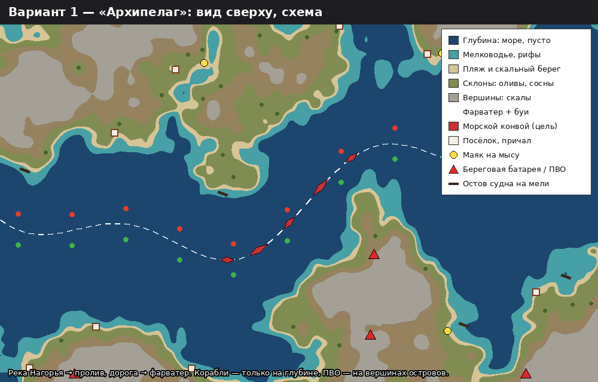

# Биом 2 — «Архипелаг» (рабочее название)

Решение Kanta 18.10.2026: вторым биомом берём «Архипелаг» (вариант 1 из четырёх). Задача E-01, дальше — E-03…E-11 в `docs/backlog.md`.
Варианты, из которых выбирали, со схемами: `/mnt/project-files/docs/biome2/README.md` (файлы проекта Claude).

## Общие правила для биома 2

- **Ритм вылета не меняется:** 15 минут, мини-боссы на 5-й (воздушный) и 10-й (наземный) минуте, финальный босс на 15-й, 4 операции кампании, как у Нагорья («Перевал», «Сухое русло», «Крепость», «Барон»).
- **Главная линия карты остаётся.** У Нагорья всё держится на реке: вдоль неё дорога, по дороге идёт конвой, поселения стоят на дне долины. В Архипелаге эту линию заменяет пролив с фарватером. Так переиспользуем код рельефа, конвоя и правил расстановки (`game/scripts/terrain3d.gd`, `docs/sprint1/s4-landscape-rules.md`), а меняем «наполнение».
- **Враги:** по концепту ~12 общих + 5–6 своих на биом. Общие (истребители, ракетоносцы, дроны, камикадзе, асы) летают везде, свои враги задают характер биома.
- **Активности те же 4** (ПВО, звено, транспортник, конвой), но каждая переодета под биом. По старому плану у второго биома больше наземных активностей.
- **Правила картинки те же** (стайл-гайд `s4-style-guide-3d-biome.md`): земля приглушённая, враги красные, ≥ 40 % кадра — спокойное место, бюджет треугольников как у Нагорья.
- **Для кода понадобится «биом как набор настроек»:** палитра, текстуры, таблица моделей, правила зон. Сейчас Нагорье зашито в код. Это общая работа для биома 2 и всех следующих; делать её будем вместе с тредом «3D-модели по плану Kirill», который сейчас переделывает ландшафт Нагорья.
- **Кредиты генераторов:** большая часть моделей во всех вариантах делается в Blender кодом, как машины конвоя v2 (`convoy_kit.py`, 0 кредитов). Meshy нужен только для природы (скалы, деревья). Входные картинки и пакет генерации покажу на утверждение до траты.

## Концепция

**Атмосфера.** Тёплое южное море с островами из светлого известняка. Бирюзовые отмели, тёмная глубина, белые домики с плоскими крышами у причалов, маяки на мысах, оливы и сосны на склонах. Война пришла с моря: береговые батареи на вершинах, остовы судов на мели, по проливу идут конвои. После сухой охры Нагорья игрок сразу видит: это новое место.

**Палитра (средние цвета, приглушённые под стайл-гайд).**
| Что | Цвет |
| --- | --- |
| Глубина | `#1e4a6e` → у края карты темнее `#173a58` |
| Мелководье, рифы | `#3f9a9a` … `#5fb3a8` |
| Пляж, песок | `#cdb88e` |
| Известняк, скалы | `#a89c88` … `#bdb2a0` |
| Склоны, зелень | `#6f7a46` (олива), `#4f6a3e` (сосна) |
| Домики | стены `#d8d0c2`, крыши `#9a6a4e` / плоские `#c8bfae` |

Свои самолёты (сталь) и красные враги хорошо читаются на тёмной воде; вражеские снаряды яркие, вода тёмная — каши не будет.

**Рельеф.** Та же сеть долин, что у Нагорья, но «залита» водой: дно долины уходит под уровень моря и становится проливом, хребты становятся островами. Профиль от пролива к острову:

| Зона | Расстояние от оси пролива | Что бывает |
| --- | --- | --- |
| Фарватер | ось пролива | корабли конвоя, буи; ничего не ставим |
| Глубина | до ~300 px | вражеские корабли, подлодки, пусто и спокойно |
| Мелководье | край глубины | рифы, отмели, остовы судов на мели, рыбацкие лодки |
| Берег | кромка суши | пляж или скальный обрыв, причалы, волнорезы |
| Прибрежная полоса | ровная суша у воды | посёлки, маяки на мысах, склады, береговое ПВО |
| Склон | подъём | оливы террасами, сосны, кусты |
| Вершина | верх острова | скалы, береговые батареи, РЛС, руины старых крепостей |

**Правила расстановки.**
| Что | Можно | Нельзя | Почему |
| --- | --- | --- | --- |
| Корабли (конвой и враги) | глубина, фарватер | мелководье, суша | сядут на мель |
| Подлодка | только глубина | у берега | ей нужна глубина |
| Береговая батарея, ПВО | вершина или ровная прибрежная полоса | склон, вода | технике нужна площадка |
| Посёлок, причал | берег у бухты | вершина, открытый мыс | людям нужна бухта |
| Маяк | мыс у фарватера | внутри бухты | его должны видеть суда |
| Остов судна | мелководье, риф | глубина, суша | судно село на мель |
| Оливы, сосны | склоны | пляж, вода | — |
| Буи | вдоль фарватера, красные с одной стороны, зелёные с другой | где попало | размечают путь |
| Обломки самолёта | где угодно; на воде — пятно масла и пена | — | падает куда попало |

**Модели (~22).**
| Модель | Чем делаем | Где ставим |
| --- | --- | --- |
| Сухогруз, танкер, катер сопровождения (конвой) | Blender кодом | фарватер |
| Катер ПВО «Скат», баржа-батарея, подлодка «Ныряльщик» (враги) | Blender | глубина |
| Корабль-носитель «Левиафан» (финальный босс), бой + ангарное качество | Blender | открытая глубина |
| Эсминец-элита «Сторож» (мини-босс 10-й минуты) | Blender (из деталей «Левиафана») | глубина |
| Летающая лодка «Альбатрос» (мини-босс 5-й минуты), гидросамолёт «Буревестник» | Meshy или Blender | воздух |
| Береговая батарея, РЛС на мачте | Blender (детали ПВО уже есть) | вершины |
| Маяк, причал, волнорез, буи, рыбацкие лодки, склад | Blender | берег, фарватер |
| Домики с плоскими и черепичными крышами (модульные) | Blender | посёлки |
| Остов судна на мели (2 вида) | Blender | мелководье |
| Скалы известняка ×2, олива, сосна | Meshy (3–4 модели, на утверждение) или переокраска абрикоса b05 и скал b01–b03 | склоны, вершины |
| Текстуры песка, известняка, гальки | CC0 (Poly Haven, ambientCG) | земля |

**Враги и боссы.**
- «Скат» — быстрый катер с зенитной установкой, ходит зигзагом.
- Баржа-батарея — медленная, ставит кольцо заградительного огня.
- «Ныряльщик» — подлодка: всплывает на 4 с, пускает ракеты и уходит под воду. Под водой неуязвима, видна только тень. Надо поймать окно.
- «Буревестник» — гидросамолёт-ракетоносец.
- «Чайки» — рой дешёвых дронов, взлетают с палубы.
- Мини-боссы: «Альбатрос» (5-я минута, воздух), «Сторож» (10-я минута, эсминец).
- **Финальный босс «Левиафан»** — корабль-носитель, уязвимые места на палубе (сверху это хорошо видно). Фаза 1: палубные ЗСУ по бортам. Фаза 2: взлёт «Чаек» и ракетные шахты. Фаза 3: главный калибр, корабль разворачивается и оставляет пенный след.

**Особенность биома — «Шквал».** Раз в несколько минут через карту полосой проходит грозовой фронт: внутри ветер сносит самолёт и пули вбок, молнии бьют в отмеченные круги. Молния бьёт и по врагам, так что их можно туда заманить. Это новое решение для игрока: обойти фронт, пролететь его быстро или драться внутри.

**Активности.** Конвой → морской конвой из 4–6 судов по фарватеру (бомбы по движущемуся судну надо бросать с упреждением). ПВО → береговая батарея на острове. Транспортник и звено — как в Нагорье.

**Операции кампании (рабочие названия):** «Пролив» → «Маяк» → «Затонувший порт» → «Левиафан».

**Цена и риски.** Код: вода с отмелями и пеной у берега (цвет по глубине — дёшево), движение кораблей по оси пролива (переиспользуем путь конвоя), поиск «глубокой воды» для кораблей рядом с поиском ровного дна для ПВО. Риск: большие участки воды выглядят пусто. Лечится пеной, рифами, тенями облаков, следами от кораблей и тем, что пролив занимает не больше половины кадра.

## Отклонённые варианты (для истории)

- «Северный фронт» (тайга, железная дорога, бронепоезд, метель) — светлые самолёты игрока теряются на снегу, густой лес тяжёл для слабых ПК. Запасной кандидат на биом 3.
- «Соляная пустошь» (нефтепромысел, горящий трубопровод) — снова тёплая пустыня, смена места после Нагорья чувствуется слабо. Идею «окружение как оружие» (поджечь трубу против колонны) можно взять в другой биом.
- «Над облаками» (почти без земли) — ломает роль штурмовика и бомбардировщика. Набросок биома 3: бой над облаками, из которых торчат вершины гор с наземными целями.

## Промпт для картинки-концепта

ChatGPT или Gemini, выбирает участник:

> Top-down game screenshot concept, camera tilted 28 degrees, fictional warm southern archipelago at war: turquoise shallows, dark deep-blue strait with a small cargo ship convoy and buoys, pale limestone islands with olive terraces and pines, small white flat-roof houses at a harbor, lighthouse on a cape, coastal gun battery on a hilltop, rusty ship wreck on a reef, soft low warm sun from upper left, muted colors, no flags, no text, no insignia, stylized 3D, readable for a bullet-heaven shooter
