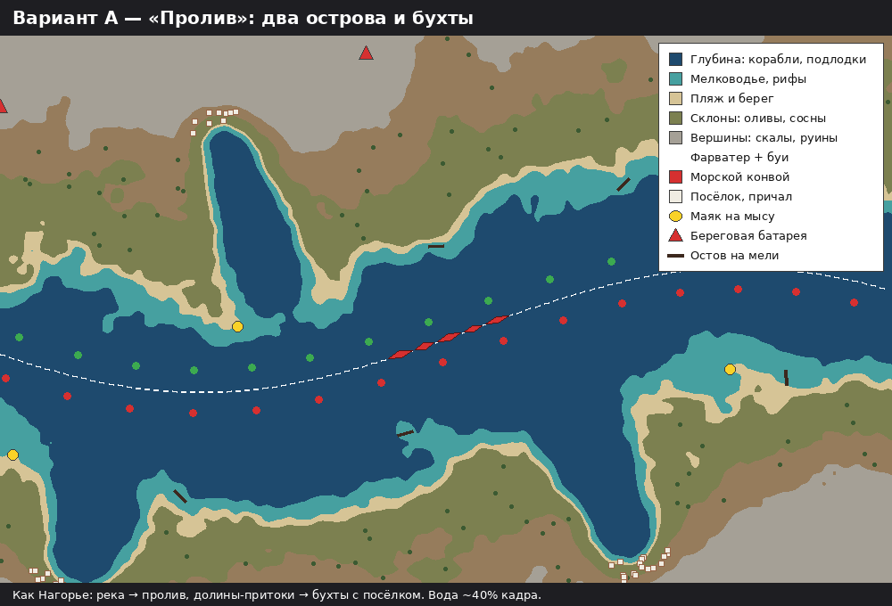
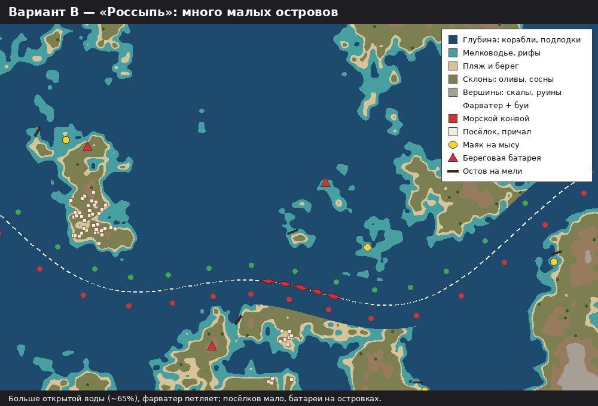
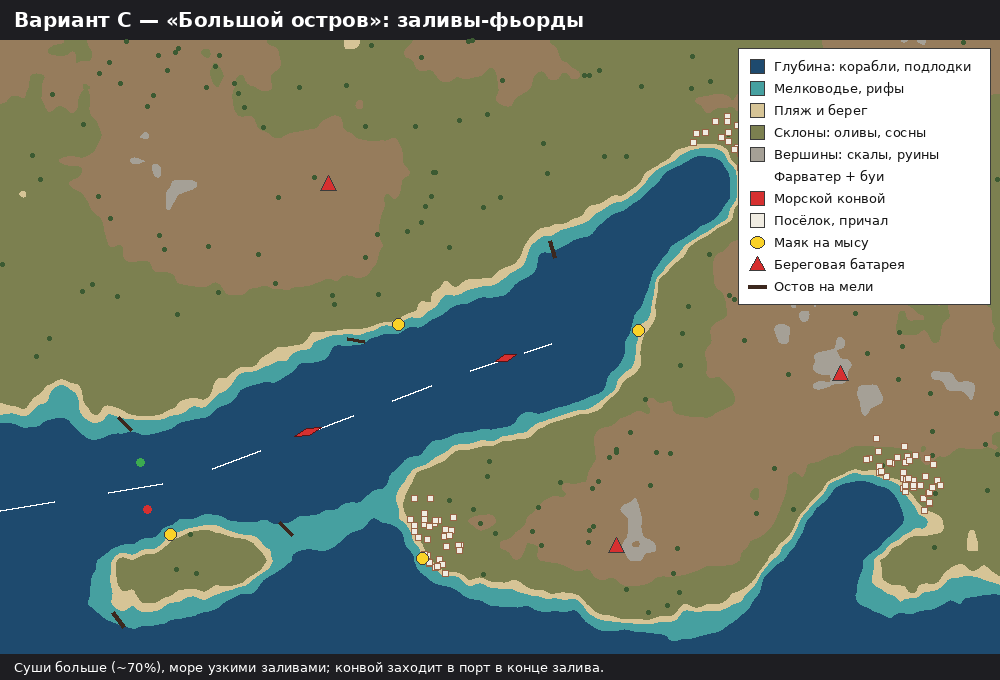
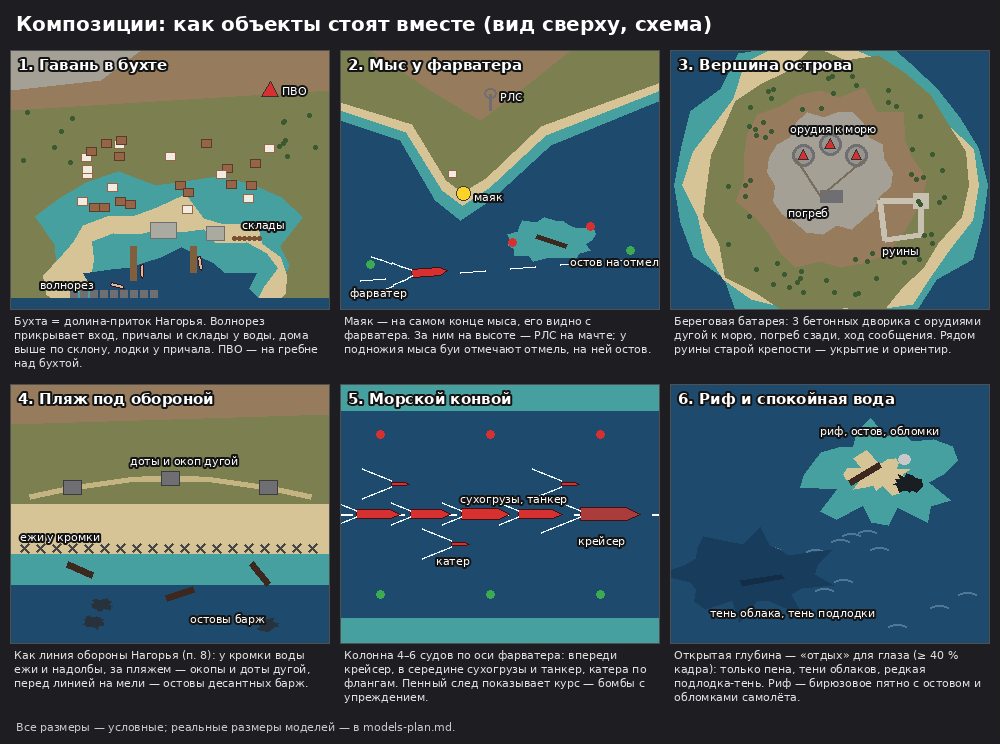

# «Архипелаг Таласора» — варианты расстановки объектов

Составлено 18.10.2026 по просьбе Kanta. Основа — правила зон из `docs/biome2/archipelago.md` и логика Нагорья (`docs/sprint1/s4-landscape-rules.md`: посёлки в долинах-притоках, линия обороны, остовы перед ней). Модели — `docs/biome2/models-plan.md`. Схемы условные: показывают, где что стоит, а не точную картинку.

Выбор идёт на двух уровнях: **1) карта целиком** (сколько воды, как идёт фарватер) и **2) композиции** — как объекты стоят группой в одном месте.

## 1. Карта целиком: три варианта

### Вариант A — «Пролив» (рекомендую)

Река Нагорья становится широким проливом, дорога — фарватером, долины-притоки — бухтами. В вершине каждой бухты посёлок с причалом (как посёлок Нагорья в долине со своим ручьём). Маяки на мысах у входа в бухты, батареи на гребнях островов, остовы на отмелях вдоль фарватера.

- Вода ~40 % кадра, суша ~60 %: есть и море, и цели на берегу.
- Конвой идёт по одной ясной линии, как колонна Нагорья — игрок сразу понимает, где цель.
- Почти весь код Нагорья переиспользуется: сеть долин, ось реки, притоки, правила зон. Меняется уровень воды и набор моделей.
- Минус: по ощущению ближе всего к Нагорью («та же долина, только с водой»). Лечится цветом, бухтами и кораблями.

### Вариант B — «Россыпь»

Открытое море с десятками малых островов, фарватер петляет между ними. Посёлки — по одному на крупный остров, батареи — на отдельных островках.

- Вода ~65 %: самое «морское» и самое непохожее на Нагорье.
- Красиво сверху, много бирюзовых отмелей.
- Минусы: мало мест для наземных целей (штурмовику и бомбардировщику скучнее); большие участки пустой воды; нужен новый генератор островов, код Нагорья подходит хуже.

### Вариант C — «Большой остров»

Один большой гористый остров, море заходит в него узкими заливами-фьордами. Конвой идёт по главному заливу к порту в его конце.

- Суша ~70 %: много места для ПВО, посёлков, крепостей.
- Сильная цель «дойти до порта» — подходит для операции «Затонувший порт».
- Минусы: моря мало — биом выглядит как «Нагорье с озёрами»; корабли в узком заливе стоят плотно.

### Можно смешать по операциям
Карта строится заново на каждый вылет, так что вариант можно менять по операции кампании:

| Операция | Вариант | Почему |
| --- | --- | --- |
| «Пролив» | A | знакомство с морем, понятный конвой |
| «Маяк» | A с бо́льшим числом мысов | много маяков и батарей на мысах |
| «Затонувший порт» | C | порт в конце залива — цель операции |
| «Левиафан» | B, но шире открытая вода в центре | боссу нужно место для разворота и пенного следа |

## 2. Композиции: как объекты стоят вместе

| № | Композиция | Где | Состав | Логика (почему так) |
| --- | --- | --- | --- | --- |
| 1 | Гавань в бухте | вершина бухты | волнорез на входе, 2–3 причала, склады и кран у воды, 20–40 домов выше по склону, лодки у причала, ПВО на гребне | людям нужна бухта и пресная вода (ручей с острова — как в Нагорье); склады у воды, дома выше от прибоя; ПВО прикрывает порт сверху |
| 2 | Мыс у фарватера | мыс у входа в бухту или у поворота фарватера | маяк на самом конце мыса, домик смотрителя, РЛС на высоте за ним, буи у отмели, остов на отмели | маяк должен быть виден с фарватера; отмель у мыса — причина и маяка, и остова |
| 3 | Вершина острова | высшая точка острова | береговая батарея (3 бетонных дворика дугой к морю), погреб сзади, ход сообщения; руины старой крепости рядом | орудия смотрят на фарватер; погреб — за гребнем от моря; крепость стояла на том же месте раньше |
| 4 | Пляж под обороной | ровный пляж у фарватера (1–2 на карту) | ежи и надолбы у кромки воды, за пляжем доты и окоп дугой, перед линией на мели остовы десантных барж | то же, что линия обороны Нагорья (правка 8): защищают место высадки, остовы — следы неудачной атаки |
| 5 | Морской конвой | ось фарватера | 4–6 судов колонной: впереди крейсер, в середине сухогрузы и танкер, по флангам 2–3 катера; пенный след | так ходят охраняемые конвои; след показывает курс, по нему игрок берёт упреждение для бомб |
| 6 | Риф и спокойная вода | открытая глубина | бирюзовое пятно рифа с остовом и обломками самолёта; на глубине — только пена, тени облаков, редкая тень подлодки | ≥ 40 % кадра должно быть спокойным (стайл-гайд), иначе каша; риф — точка интереса посреди воды |

### Чего не бывает (правила-запреты)
- Корабли не заходят на мелководье и в бухты мельче их осадки; подлодка — только на глубине.
- Батарея и ПВО не стоят на склоне и у самой воды — только вершина или ровная площадка.
- Посёлок не стоит на открытом мысу и на вершине.
- Маяк не стоит внутри бухты.
- Остовы — только на мели, не на глубине и не на суше.
- Поля и сады — на террасах склона, не на пляже и не внутри посёлка (как исправили в Нагорье).
- Мешки с песком и окопы не идут сквозь орудийный дворик — упираются в него (как исправили в Нагорье).

### Сколько чего на одну карту (вылет 15 минут, для варианта A)
| Что | Сколько | Примечание |
| --- | --- | --- |
| Гавани с посёлком | 4–6 | по одной на бухту |
| Мысы с маяком | 3–5 | у входа в бухты |
| Вершины с батареей | 4–6 | активность ПВО берёт одну из них |
| Пляжи под обороной | 1–2 | редкое событие, запоминается |
| Рифы с остовом | 6–10 | вдоль фарватера, чаще у мысов |
| Морской конвой | 1 активный + 1–2 «фоновых» судна на якоре в гаванях | фоновые — цели по желанию |
| Буи | пара на каждые ~400 px фарватера | красные с одной стороны, зелёные с другой |

## Вопросы Kanta

1. **Карта целиком:** 1 — вариант A везде; 2 — смешать по операциям (таблица выше); 3 — B везде; 4 — C везде. **Рекомендую 2**: старт с A (дешевле всего, код Нагорья), а B и C добавить к своим операциям, когда A заработает.
2. **Композиции 1–6** — все берём или что-то убрать/добавить? **Рекомендую взять все 6**.
3. **Пляж под обороной (4)** — 1 — оставить как отсылку к линии обороны Нагорья; 2 — убрать, чтобы не повторяться. **Рекомендую 1**.

Код карты и расстановки начинается только по команде (как и модели).
