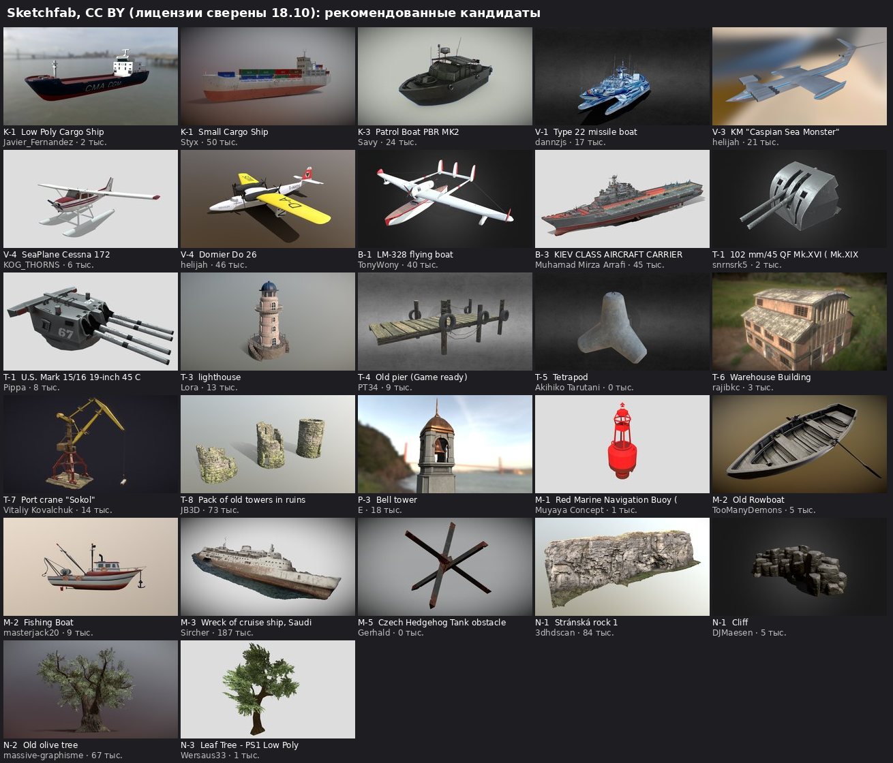

# «Архипелаг Таласора» — свободные модели с Sketchfab

Подборка 18.10.2026 по просьбе Kanta. Номера — как в `docs/biome2/models-plan.md`. Искал только модели, которые разрешено скачивать, с лицензией **CC BY 4.0** (можно менять и продавать, автора указываем в титрах) или **CC0** (без условий). **Проверка 18.10:** лицензия и разрешение на скачивание сверены на странице каждой модели (все — CC BY); описания проверены на «ripped / из игры». Две модели автора 42manako (корвет и крейсер-носитель «Kiev-class») убраны: автор пишет, что вытащил их из чужих игр, значит, лицензия CC BY на них недействительна. Перед скачиванием Kanta ещё раз смотрит на странице, что лицензия не поменялась.

**Правила, как с танкером:**
- Как есть не берём: облегчаем до бюджета боя (2–15 тыс. треугольников), перекрашиваем в наши цвета, убираем названия, номера, флаги и знаки, меняем 2–3 заметные детали силуэта (модели реальной техники — только «по мотивам»).
- Каждая взятая модель — строка в титрах: автор, название, ссылка, «CC BY 4.0, изменено». Список ведём в `game/models/CREDITS.md` с первой модели.
- Не берём модели, в описании которых сказано, что они взяты из игр или чужих работ (ripped, extracted), даже если стоит CC BY.
- Скачивание на Sketchfab требует входа в аккаунт, поэтому файлы скачивает Kanta (формат glTF/GLB или .blend) и присылает в тред с номером модели.
- Где модели нет или она плохая — собираем кодом, как планировали.

## Уже присланы Kanta

| № | Модель | Автор | Лицензия | Треуг. | Ссылка |
| --- | --- | --- | --- | --- | --- |
| К-1 | Bulk Carrier | medialog | CC BY | 1,6 млн | https://sketchfab.com/3d-models/93c076900f004102b78dfac989efae1d |
| К-2 | Tanker Ship (файл .blend у нас) | Art Blender | CC BY | 193 тыс. | https://sketchfab.com/3d-models/96ebf61af42b4062ae98a6ad848e1a25 |
| В-3 | экраноплан — 13 кадров (`/mnt/project-files/docs/biome2/refs/V-3_ekranoplan/`) | — | ждём ссылку, если это модель | — | — |

## Найдено (кандидаты)

Первая строка в группе — что рекомендую.

| № | Модель | Автор | Лиц. | Треуг. | Ссылка | Заметка |
| --- | --- | --- | --- | --- | --- | --- |
| К-1 | Low Poly Cargo Ship | Javier_Fernandez | CC BY | 2 тыс. | https://sketchfab.com/3d-models/4c22cbaf01c1427f8ab60b3a07b1b32c | уже лёгкая; запасной вариант к модели Kanta |
| К-1 | Small Cargo Ship | Styx | CC BY | 51 тыс. | https://sketchfab.com/3d-models/6362d3e9b11e4396aaafa854c3aa6f06 | каботажное судно с контейнерами |
| К-1 | Cargo ship | hungry_drifter | CC BY | 73 тыс. | https://sketchfab.com/3d-models/b7c97df584824ca682d26daabf401f87 | с грузовыми стрелами |
| К-3 | Patrol Boat PBR MK2 | Savy | CC BY | 25 тыс. | https://sketchfab.com/3d-models/dbd87172b2934063aa93ffd0c6f85750 | катер сопровождения |
| К-3 | M21 Patrol Boat | gogiart | CC BY | 253 тыс. | https://sketchfab.com/3d-models/598d3938b4214f2e9f385c29b3a3744a | тяжёлая |
| К-5 | LCVP Higgins boat (1945) | RedC130 | CC BY | 170 тыс. | https://sketchfab.com/3d-models/92b2ec48991545f7baea8b0954489be8 | десантный бот; баржу проще кодом |
| В-1 | Type 22 missile boat | dannzjs | CC BY | 18 тыс. | https://sketchfab.com/3d-models/d90464e6ca2e4d23a7a5a9865d220945 | катамаран — хороший силуэт для «Ската» |
| В-3 | KM "Caspian Sea Monster" | helijah | CC BY | 22 тыс. | https://sketchfab.com/3d-models/78de2c2921064278a320aa9f5add63fb | экраноплан, вес как раз |
| В-4 | SeaPlane Cessna 172 | KOG_THORNS | CC BY | 6 тыс. | https://sketchfab.com/3d-models/3924196d2ccf42c0ac8458d8f16a7910 | лёгкий гидросамолёт для «Буревестника» |
| В-4 | Dornier Do 26 | helijah | CC BY | 47 тыс. | https://sketchfab.com/3d-models/16bcea70c43b4e0198a0cb4240b715d8 | крыло «чайкой», 4 мотора |
| Б-1 | LM-328 flying boat | TonyWony | CC BY | 40 тыс. | https://sketchfab.com/3d-models/d34a38da8ac6454cbdea645433b8d45b | летающая лодка для «Альбатроса» |
| Б-1 | Dornier Do X | helijah | CC BY | 235 тыс. | https://sketchfab.com/3d-models/480eff9cea88495ba83bd32aa26eabde | огромная, 12 моторов |
| Б-3 | KIEV CLASS AIRCRAFT CARRIER | Muhamad Mirza Arrafi | CC BY | 46 тыс. | https://sketchfab.com/3d-models/f854eda1eab54a40aae8628e6456ae78 | крейсер-носитель с ракетами — ближе всего к «Левиафану» |
| Б-3 | Type-004 Aircraft Carrier | Muhamad Mirza Arrafi | CC BY | 30 тыс. | https://sketchfab.com/3d-models/0953bebe3ae34d7582fe0e2bcff0925f | чистый авианосец |
| Т-1 | 102 mm/45 QF Mk.XVI | snrnsrk5 | CC BY | 3 тыс. | https://sketchfab.com/3d-models/2389fa9c28024f908eebbb16803450c3 | орудие для дворика батареи |
| Т-1 | 150 mm/55 SK C/28 | snrnsrk5 | CC BY | 4 тыс. | https://sketchfab.com/3d-models/1a0f08246a0f4ccf832616053b3dc5e4 | башня покрупнее |
| Т-1 | Mark 15/16 Turret | Pippa | CC BY | 9 тыс. | https://sketchfab.com/3d-models/1284145fb0e8419c97ae487cbf08ff16 | главный калибр для «Левиафана» |
| Т-1 | Devil's Slide Bunker | Azad Balabanian | CC BY | 91 тыс. | https://sketchfab.com/3d-models/52982f5a24834be48dab4057d2df1c3d | скан берегового бункера на скале |
| Т-3 | lighthouse | Lora | CC BY | 13 тыс. | https://sketchfab.com/3d-models/dab98033118949728804bfc5f4076b8f | маяк, вес подходит |
| Т-3 | Old Lighthouse | Nirved Kamble | CC BY | 80 тыс. | https://sketchfab.com/3d-models/19e1ff049db74dc8b6173976417c1048 | каменный |
| Т-4 | Old pier (Game ready) | PT34 | CC BY | 9 тыс. | https://sketchfab.com/3d-models/3c21842960a74452a13609a584f38762 | деревянный причал |
| Т-4 | Simple Wooden Pier or Dock | Jungle Jim | CC BY | 6 тыс. | https://sketchfab.com/3d-models/5bf117cb734a46559d10971c3098165c | |
| Т-5 | Tetrapod | Akihiko Tarutani | CC BY | 0,5 тыс. | https://sketchfab.com/3d-models/58cc4e3db5c84bca9ae714b9e116cc04 | бетонный блок волнореза, из него набираем дугу |
| Т-6 | Warehouse Building | rajibkc | CC BY | 3 тыс. | https://sketchfab.com/3d-models/08a4f422bc634033b8023d53beaf8242 | склад |
| Т-6 | Warehouses | 99.Miles | CC BY | 2 тыс. | https://sketchfab.com/3d-models/e6e105d35b3f486292c42ffa52f363c0 | ряд складов |
| Т-7 | Port crane "Sokol" | Vitaliy Kovalchuk | CC BY | 14 тыс. | https://sketchfab.com/3d-models/4964eaa7634e47c9bac4c2a74fa91c20 | портовый кран |
| Т-8 | Pack of old towers in ruins | JB3D | CC BY | 73 тыс. | https://sketchfab.com/3d-models/f213359c6cbb4c29bf8880764faa0fb8 | разрушенные башни крепости |
| Т-8 | Ancient Fortress Asset Pack - Part 2 | EqualizerX | CC BY | 117 тыс. | https://sketchfab.com/3d-models/43cab28dea5a47f69f8e30640cb9dd50 | стены и башни набором |
| П-1 | Èze Village - France | Azad Balabanian | CC BY | 302 тыс. | https://sketchfab.com/3d-models/a18a1449661643e6ab98640a3e7eafc1 | скан деревни на скале — только как образец; дома делаем кодом |
| П-3 | Bell tower | E | CC BY | 19 тыс. | https://sketchfab.com/3d-models/2c37ee1b658d45b0a4af9b9b5257d80f | колокольня (без символов на верхушке) |
| М-1 | Red Marine Navigation Buoy | Muyaya Concept | CC BY | 1 тыс. | https://sketchfab.com/3d-models/519c88ea6d464e29988515af989a96e6 | буй, лёгкий |
| М-2 | Old Rowboat | TooManyDemons | CC BY | 5 тыс. | https://sketchfab.com/3d-models/9922d5678af84adeb1c9b479856446ca | вёсельная лодка |
| М-2 | Fishing boat | Pabooklas | CC BY | 7 тыс. | https://sketchfab.com/3d-models/f4b38ccf5ffb46018aa7931c0e106654 | |
| М-2 | Fishing Boat | masterjack20 | CC BY | 10 тыс. | https://sketchfab.com/3d-models/649c006b72e748bf84e7cda011faaff2 | с рубкой |
| М-3 | Wreck of cruise ship, Saudi Red Sea Coast | Sircher | CC BY | 187 тыс. | https://sketchfab.com/3d-models/0c3b206157764a358fb2b16e4d90f0b3 | скан остова, накренён |
| М-3 | Point Reyes Shipwreck | David Antalek | CC BY | 250 тыс. | https://sketchfab.com/3d-models/b93140adf486475db064eab7da4a675a | скан деревянного судна на мели |
| М-5 | Czech Hedgehog Tank obstacle | Gerhald | CC BY | 1 тыс. | https://sketchfab.com/3d-models/fcb063a945c94d71936805e1ddbed288 | противотанковый ёж |
| Н-1 | Cliff | DJMaesen | CC BY | 6 тыс. | https://sketchfab.com/3d-models/082da1166a814c6e9c9e6c1b38159e4e | уступ, лёгкий |
| Н-1 | Stránská rock 1 | 3dhdscan | CC BY | 84 тыс. | https://sketchfab.com/3d-models/4118802ad14243d59f34c2be3fa77cd4 | скан светлой скалы — похоже на известняк |
| Н-1 | Free_cliff_rock | Kwinto | CC BY | 41 тыс. | https://sketchfab.com/3d-models/75fb6b34dc0d46259dedc8c7cd94e7b7 | высокий утёс |
| Н-2 | Old olive tree | massive-graphisme | CC BY | 67 тыс. | https://sketchfab.com/3d-models/6328df8a0f214143a880a72b86db2ab4 | олива, облегчим |
| Н-2 | Olive Tree Portugal | CeDRI | CC BY | 78 тыс. | https://sketchfab.com/3d-models/e0b57e421ac546c6b7e4cb563f524640 | |
| Н-3 | Leaf Tree - PS1 Low Poly | Wersaus33 | CC BY | 2 тыс. | https://sketchfab.com/3d-models/d799c08100974e1ba352fcd646cb0694 | крона «зонтиком», ближе всего к средиземноморской сосне |

## Не нашлось — Kanta ищет или делаем кодом

| № | Что | Что искать |
| --- | --- | --- |
| В-2 | Баржа-батарея | «flak barge», «pontoon barge»; иначе кодом (плоская баржа + наши зенитки) |
| В-5 | Дрон «Чайка» | берём общих дронов игры |
| Т-2 | РЛС на мачте | «lattice radar tower», «radar mast»; иначе кодом (детали РЛС ПВО есть) |
| П-1, П-2 | Домики посёлка | готовых в нужном виде нет — кодом, как дома Нагорья |
| Н-3 | Сосна «зонтиком» | «stone pine», «umbrella pine», «italian pine» |
| К-4 / Б-2 | Крейсер «Сторож» | делается в треде вертолёта по кадрам Kanta |
