# Каталог техники и оружия Flak Heaven

Снимок на 16.10.2026: код `main` (после PR #21) плюс открытый PR #22 (3D-ангар, оружие по уровням, турели). Все картинки отрендерены в облаке из файлов моделей, которые сейчас лежат в проекте.

**Разбор владельцем 16.10:** решения, задачи и вопросы — в [plan-after-review.md](plan-after-review.md). Бой переводится на 3D-модели (решение 14.10), исполнение — тред «Задачи по 3D и биому».

**Как читать картинки.** Полоса из четырёх кадров: слева, за серой чертой, спрайт, из которого игра строит объёмный самолёт в бою; дальше 3D-модель в трёх видах: 3/4 спереди, сверху (как видит игрок), сбоку. У оружия три кадра: ступень вида 1, 2 и 3.

**Пометки в разделах «Что доработать»:**
- 🔴 мешает или нарушает правило проекта (знаки, реальная копия, лежит на боку);
- 🟡 заметно на глаз, стоит сделать при чистке в Blender;
- ⚪ мелочь или вопрос на решение.

---

## 0. Главное, что видно по всему каталогу

1. **В бою 3D-модели пока не используются.** Свой самолёт, ведомые, враги и наземные цели в бою строятся из плоского спрайта: игра «выдавливает» силуэт картинки в объём (рельеф). Модели Meshy показываются только в ангаре (PR #22). Модели врагов и наземной техники лежат в `game/models/pilot/`, но в игру не подключены и исключены из сборки. Поэтому чистка моделей в Blender сама по себе картинку в бою не изменит. Нужно решение: переводим бой на настоящие 3D-модели (лучше вид, особенно на наклонной камере 28°; дороже по FPS на слабых ПК) или оставляем рельеф и чистим только модели ангара. Рекомендация: перевести бой на облегчённые модели 5–15 тыс. треугольников (так решено 14.10), начиная со своих самолётов, и замерить FPS на твоём ноутбуке.
2. **Знаки и надписи.** На «Почтальоне» и «Сопернике» эмблемы на киле, на заправщике и транспортнике бортовые номера, на «Граче 2» квадрат-«наклейка» на борту. По правилу 4 их нужно стереть с текстуры.
3. **Слишком похожи на реальные машины.** Транспортник почти копия известного четырёхмоторного транспортника, заправщик почти копия широкофюзеляжного лайнера, «Кит 1» и «Кит 2» очень близки к известным бомбардировщикам. По правилу «по мотивам» стоит изменить 2–3 заметные детали силуэта (форму киля, число и место двигателей, законцовки крыла).
4. **Оружие пока из простых фигур** (цилиндры, коробки). Ступени 1 и 2 у части оружия почти не отличаются, а ступень 3 бомб выглядит слабее ступени 2. У эволюций («Шмель», «Ливень» и др.) своего вида нет: они показываются как ступень 3.
5. **Турели.** Нынешние турели из кода (раздел 2.6) ты оценила как «очень плохо». Им на замену в Blender уже сделаны турели «Кита» и «Грача» (раздел 2.7), их сейчас ставят в PR #22.

---

## 1. Самолёты игрока

Каждый класс есть в двух уровнях. Ур. 2 покупается в ангаре («Самолёт ур. 2 — комплект модернизации»: нужен экипаж ур. 3 и 1500 запчастей; даёт прочность +15%, скорость и разворот +5%, +1 переброс). Модели ангара — Meshy максимального качества, 50 тыс. треугольников, текстуры 2K (PR #22). Облегчённые версии для боя (10–15 тыс.) лежат в `game/models/pilot/`, в бою пока не используются (см. п. 0.1).

### 1.1 Истребитель «Оса»
Лёгкий класс: скорость, манёвр, уклонение. Прочность 120. Подвесы: «Крылья (пара)» (старт: ракеты В-В) и «Под фюзеляжем» (пусто). Турелей нет, 1 ведомый. На «Пробеле» бочка.

**«Оса 1»** (Meshy): двухкилевой истребитель, голубой камуфляж.
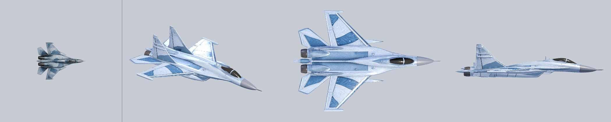

**«Оса 2»** (Hunyuan, затем Meshy HQ): двухместная кабина, крупнее, серый металл.
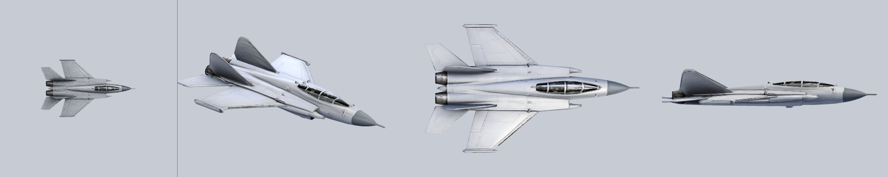

**Эволюция 1 → 2:** читается хорошо: другой силуэт, двухместная кабина, другой цвет.

**Что доработать:**
- 🟡 «Оса 2»: кили тёмно-серые и не совпадают по тону с фюзеляжем, выглядят как чужая деталь.
- 🟡 «Оса 2» потеряла голубой камуфляж «Осы 1». Лучше оставить общую окраску класса, чтобы игрок узнавал «свой» самолёт (и под будущую косметику).

### 1.2 Штурмовик «Грач»
Средний класс: живучесть, усиленная пушка, турель. Прочность 160. Подвесы: «Внутренняя пара» (старт: НАР) и «Внешняя пара» (пусто). 1 турель за кабиной.

**«Грач 1»** (Meshy): одноместный штурмовик, двигатели в гондолах по бокам фюзеляжа, зелёно-песочный камуфляж.
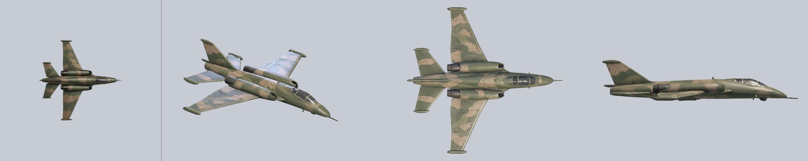

**«Грач 2»** (Meshy): двухместная кабина, серо-зелёный камуфляж.
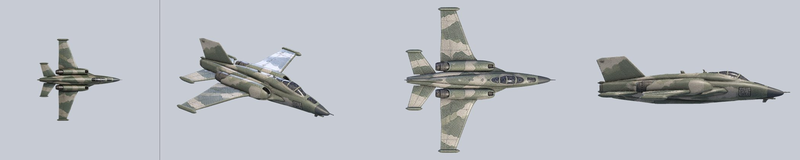

**Эволюция 1 → 2:** слабая. Силуэт почти тот же, отличаются кабина и оттенок камуфляжа. Сверху, как видит игрок, разница почти не видна.

**Что доработать:**
- 🔴 «Грач 2»: на борту под кабиной квадрат с узором, похожий на наклейку или код. Стереть.
- 🟡 Оба «Грача»: на левом крыле светлое голубое пятно (шов текстуры Meshy), видно на виде 3/4.
- 🟡 «Грач 2»: добавить отличие, заметное сверху: другие законцовки крыла, длиннее нос, бронеплиты кабины или наплывы.
- ⚪ Место под турель: на спине за кабиной нет посадочного погона, турель ставится «на поверхность». В Blender можно вырезать погон.

### 1.3 Бомбардировщик «Кит»
Тяжёлый класс: прочный, 3 турели, бомбы по земле. Прочность 250. Подвесы: «Бомбоотсек» (старт: бомбы) и «Крылья (пара)» (пусто). 3 турели: корма, спина, брюхо. 2 ведомых. На «Пробеле» залп ловушек.

**«Кит 1»** (Meshy): четыре турбовинтовых двигателя на стреловидном крыле, голый металл. Винты крутятся (PR #18).
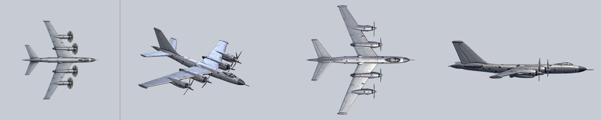

**«Кит 2»** (Meshy): реактивный бомбардировщик с крылом изменяемой стреловидности, два двигателя у хвоста.
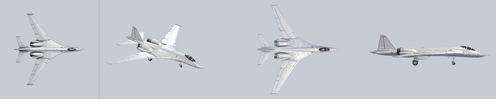

**Эволюция 1 → 2:** читается отлично: винты → реактивные двигатели, совсем другой силуэт.

**Что доработать:**
- 🔴 «Кит 2»: выпущены шасси (колёса под крылом и носом). В полёте их не должно быть, убрать в Blender.
- 🔴 Оба «Кита» очень близки к реальным бомбардировщикам. Изменить 2–3 детали силуэта (киль, гондолы, форма носа).
- 🟡 Оба «Кита» без окраски, голый металл. Остальные классы в камуфляже, для «Кита» нужна своя окраска класса (песочная, по цвету класса в интерфейсе).
- 🟡 «Кит 2»: в корме нет места под кормовую установку (там реактивные сопла). Решить, куда ставить кормовую турель на ур. 2, или оставить ему только верхнюю и нижнюю.
- ⚪ «Кит 1»: остеклённого носа штурмана нет. Его можно добавить для образа бомбардировщика.

### 1.4 Как самолёты выглядят в ангаре с оружием
Кадры из самой игры (PR #22, вкладка «САМОЛЁТ»): ур. 1 с оружием ступени 1, 2, 3, затем ур. 2 со ступенью 1. Ракурс на кадрах разный, потому что модель в ангаре медленно вращается сама.

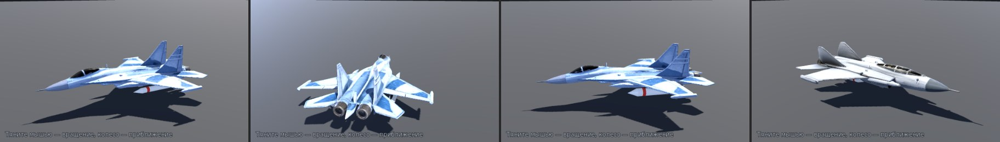
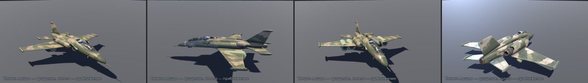
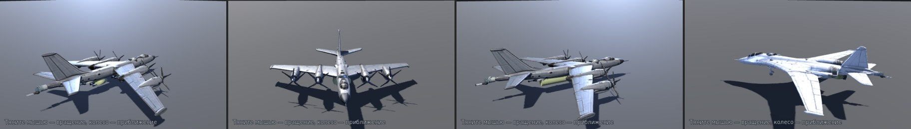

**Что доработать в ангаре:**
- 🟡 Модель занимает небольшую часть окна; можно поднять камеру ближе по умолчанию.
- 🟡 Показывается только стартовое оружие класса. Чтобы «рассматривать вооружение» (правка 1), нужен выбор: что повесить на каждую группу подвесов.

---

## 2. Оружие и его эволюции

Оружие качается в вылете до ур. 5. Вид меняется ступенями (PR #22): **ступень 1** — ур. 1–2, **ступень 2** — ур. 3–4, **ступень 3** — ур. 5 и эволюция. Модели строятся кодом из простых форм (`weapon_models.gd`), кредиты Meshy не тратятся. Всё подвесное висит под крылом на пилоне.

У каждого оружия есть эволюция (именная форма), она открывается катализаторами-модулями.

### 2.1 Ракеты «воздух-воздух»
1 ракета с точки, самонаведение по приоритету. Ур. 2–5: +30% урона, −10% перезарядки; ур. 4: ещё +80% урона и +20% скорости. По твоему решению 15.10 ракеты не множатся, а улучшаются.
**Эволюция «Шмель»** (катализатор: модуль «Быстрая перезарядка» ×2): 2 тяжёлые ракеты каждые 4,5 с, урон 120, при попадании делятся на 4 самонаводящиеся БЧ.

Ступени: обычная ракета → крупнее, на пусковой балке → тяжёлая, с ускорителем.
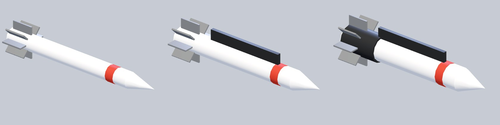

**Что доработать:**
- 🟡 Ступени 1 и 2 почти одинаковые: ракета толще на 20% и с балкой. Сверху, в бою, разницы не видно.
- 🟡 Нет головки самонаведения (тёмного носа) и передних рулей, ракета похожа на НАР.
- ⚪ «Шмель» стоит отдельного вида: толстая ракета с кольцом из 4 БЧ вокруг корпуса.

### 2.2 Блок НАР
Залп из 4 ракет с точки, взрыв по площади. Ур. 2–5: +40% урона, +10% радиуса.
**Эволюция «Ливень»** (катализатор: модуль «Форсированный двигатель» ×2): залп веером в 3 стороны по 5 ракет.

Ступени: малый блок → большой блок → два блока.
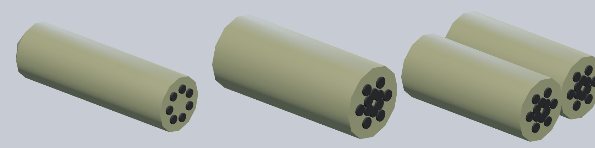

**Что доработать:**
- 🟡 Блок — голый цилиндр без обтекателя-конуса спереди и сзади; у настоящих блоков нос закруглён.
- ⚪ Ступень 3 «два блока» висят рядом, без общей балки; нужна сдвоенная подвеска.

### 2.3 Пушечная гондола
Поворотная пушка, сама наводится на цели. Ур. 2–5: +25% урона, +10% темпа и дальности.
**Эволюция «Газонокосилка»** (катализатор: модуль «Сервоприводы» ×2): два ствола поочерёдно, пуля пробивает цель.

Ступени: 1 ствол → 2 ствола → 3 ствола в кожухе.
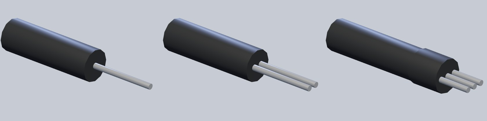

**Что доработать:**
- 🟡 Корпус — чёрный цилиндр без формы: нет заострённого носа и хвостового обтекателя.
- 🟡 Описание говорит «поворотная», а модель неподвижная. Либо поворотная головка, либо поправить описание.
- ⚪ «Газонокосилка» — два ствола, а ступень 3 показывает три. Сверить.

### 2.4 Тепловые ловушки
Отстрел ловушек: ракета уходит на вспышку. Ур. 2–5: −10% перезарядки, +8% радиуса; ур. 4: две ракеты за раз.
**Эволюция «Салют»** (катализатор: навык «Бочка: тренировка» ×2): уводит 2 ракеты, каждый перехват выпускает 3 самонаводящиеся ловушки.

Ступени: малый кассетник → большой → два.
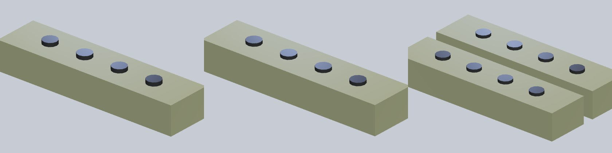

**Что доработать:**
- 🔴 Это просто оливковые бруски с кружками. Ступени 1 и 2 неотличимы.
- 🟡 Настоящие кассеты ловушек обычно встроены в фюзеляж или хвост, а не висят на пилоне. Предлагаю ставить их в хвостовую часть или у основания крыла, а на ступенях добавлять ряды ячеек.

### 2.5 Кассетные бомбы
Бомбы только по наземным целям: взрыв по площади, урон ×2 по земле. Ур. 2–5: +25% урона, +10% радиуса, −8% перезарядки.
**Эволюция «Бабушкин ковёр»** (катализатор: модуль «Осколочная рубашка» ×2): каждые 4 с ряд из 8 бомб поперёк курса.

Ступени: 2 бомбы → 4 бомбы → кассета.
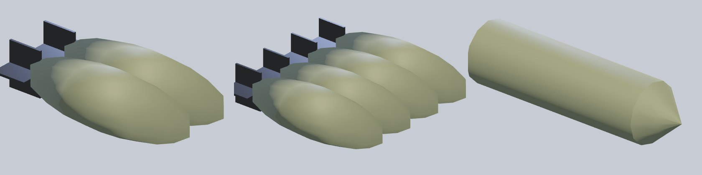

**Что доработать:**
- 🔴 Ступень 3 (кассета) выглядит слабее ступени 2: один гладкий цилиндр вместо четырёх бомб. Нужна крупная кассета со стабилизаторами и замками, или 6 бомб на балке.
- 🟡 Стабилизаторы у бомб — плоские пластинки; нужны крестообразные с кольцом.
- ⚪ У «Кита» бомбы висят «в бомбоотсеке», но створок отсека на модели нет. Можно нарисовать створки на брюхе в Blender.

### 2.6 Турели из кода (текущие в PR #22, заменяются)
Встроенные, кругового обстрела. Ур. 2–5: +15% урона, +10% темпа.
**Эволюция «Дикобраз»** (катализатор: модуль «Бронеплиты» ×3): у каждой турели 2 ствола, дальность +40%, турель сбивает ракету раз в 1,5 с.

Выбран вариант 3 «смешанный»: в корме остеклённая кабина стрелка, сверху и снизу дистанционные башни. Ступени: спарка лёгких пушек → спарка тяжёлых с дульными тормозами → то же + прицел-радар.

Кормовая установка:
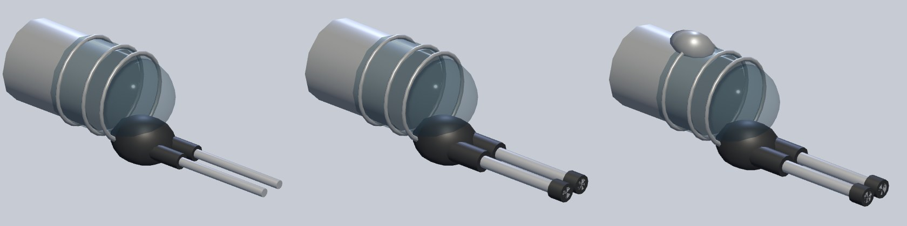
Верхняя башня:
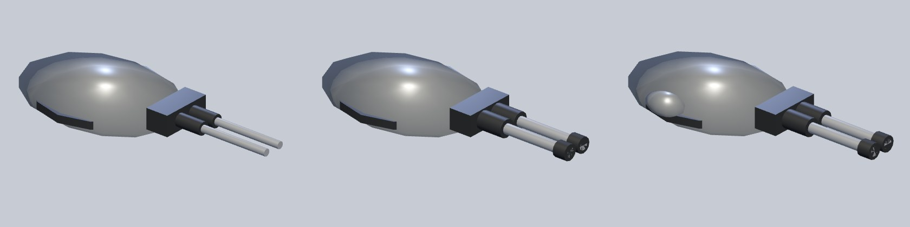
Нижняя башня:

**Что доработать:**
- 🔴 Твоя оценка 16.10: «всё ещё очень плохо». Заменяются турелями из Blender (2.7).
- 🟡 Ступени 1 и 2 почти не отличаются, ступень 3 добавляет только маленький шарик-радар.
- ⚪ «Дикобраз» уже даёт 2 ствола, а у турелей спарка с первой ступени. Сверить с описанием эволюции.

### 2.7 Новые турели из Blender (по твоим фото, 16.10)
**«Кит»**: тяжёлая спаренная турель: поворотный погон, бронированная башня, два длинных ствола с дульными тормозами. 3,5 тыс. треугольников.
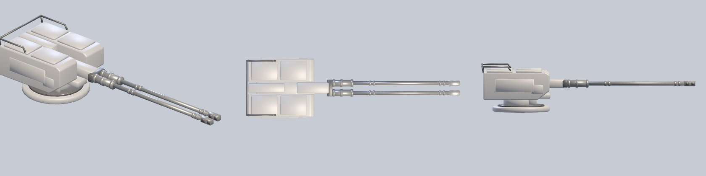

**«Грач»**: компактная турель среднего класса: низкая тумба, скошенный лоб, два коротких ствола. Примерно вдвое короче и проще турели «Кита». 2 тыс. треугольников.
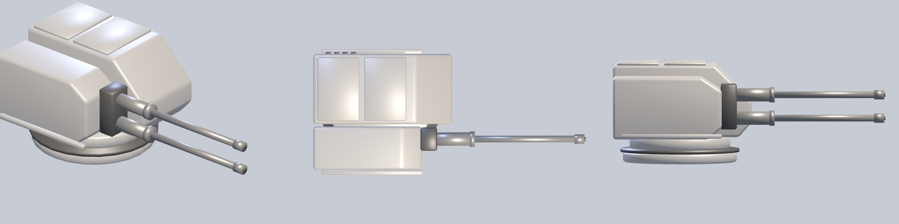

Сравнение с фото: [turret_kit_v1.jpg](/mnt/project-files/turrets3d/turret_kit_v1.jpg), [turret_grach_v1.jpg](/mnt/project-files/turrets3d/turret_grach_v1.jpg).

**Что доработать:**
- 🟡 Серые, без окраски: покрасить в цвет самолёта (в работе в треде «Задачи по 3D и биому»).
- 🟡 Ступени 1/2/3 и «Дикобраз» для новых турелей пока не придуманы. Предложение: ступень 1 — без дульных тормозов, ступень 2 — с тормозами и щитком, ступень 3 — с прицельной головкой и коробами лент.
- ⚪ Для кормовой установки «Кита» нужна своя форма (кабина стрелка), башня с фото подходит для верха и низа.

### 2.8 Чего в оружии нет совсем
- **Модули самолёта без вида.** «Форсированный двигатель» (твой пример из правки 3: «шире сопло»), «Бронеплиты» и другие модули в игре есть как карточки, но на модели самолёта никак не видны. Предложение: двигатель — шире сопло и кольцо, на ур. 5 синий факел форсажа; бронеплиты — накладные плиты на кабине и боках.
- **Курсовая пушка** и её эволюция **«Дятел»** не показаны на модели: нет ствола или дульного среза в носу.
- **Пилоны.** Под крылом оружие висит на коротком выступе; отдельной модели пилона нет.

---

## 3. Ведомые

В бою используют спрайты игрока: «Стриж» (прикрытие) и «Ласка» (подавитель ПВО) — спрайт «Осы 1», «Грачонок» (штурмовик) — спрайт «Грача 1».

**Что доработать:**
- 🟡 Ведомые неотличимы от игрока, кроме размера (0,85). Нужна хотя бы своя окраска или полоса на крыле, а «Ласке» — своя подвеска (противорадарная ракета).

---

## 4. Враги в воздухе

В бою — рельеф из спрайта; 3D-модели Meshy 6–12 тыс. треугольников в бой не подключены. Общая окраска врагов — тёмный металл с красными законцовками, хорошо отличается от игрока.

### 4.1 Перехватчик
Базовый враг: стреляет очередью из 3 пуль, заходит на атаку. Сопровождает транспорт и атакует заправщик.
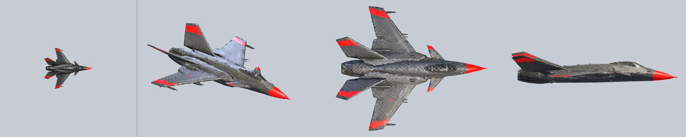
- ⚪ Модель чистая. Можно сделать мельче, чтобы отличалась от асов.

### 4.2 Ас-соперник (догфайт)
Ас с позывным и радиорепликами садится на хвост, активность «Догфайт».
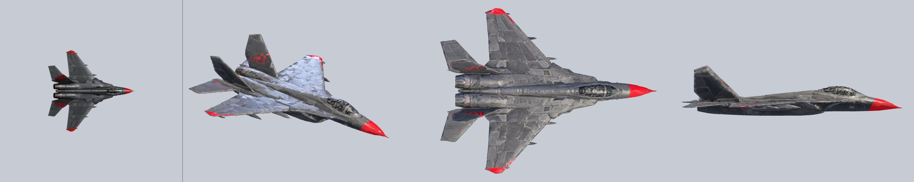
- 🔴 Красная эмблема на киле. Стереть.
- 🟡 Силуэт почти как у перехватчика; асу нужна заметная окраска (своя полоса или раскраска носа).

### 4.3 «Сквозняк» (ас, также босс)
Быстрый ас; его спрайт используется и для босса.
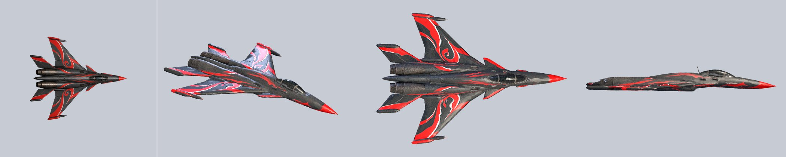
- ⚪ Яркая красная раскраска, хорошо читается. Проверить, что узор не похож на реальный знак.

### 4.4 «Почтальон» (ас, также босс-носитель)
Ас с ракетами под крылом; его спрайт используется и для босса-носителя.
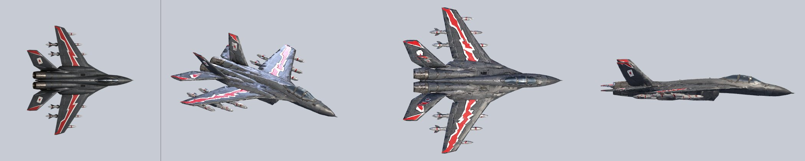
- 🔴 Белая эмблема на киле. Стереть.
- 🟡 Ракеты нарисованы прямо в модели. Для босса это нормально, но они не совпадают с реальными пусками.

### 4.5 Ракетоносец
Пускает ракеты с предупреждением (телеграфом).
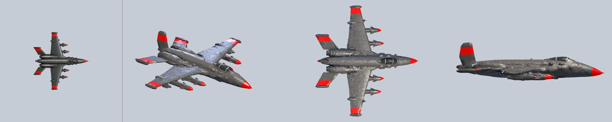
- ⚪ Модель чистая, ракеты под крылом читаются.

### 4.6 Дрон
Стреляет одиночными с жёлтым телеграфом, летает цепью.
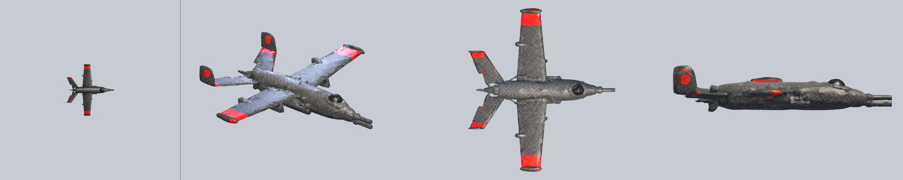
- ⚪ Модель чистая. Красный круг на киле может читаться как знак, лучше заменить полосой.

### 4.7 Дрон-камикадзе
Таранит игрока, мигает перед ударом.
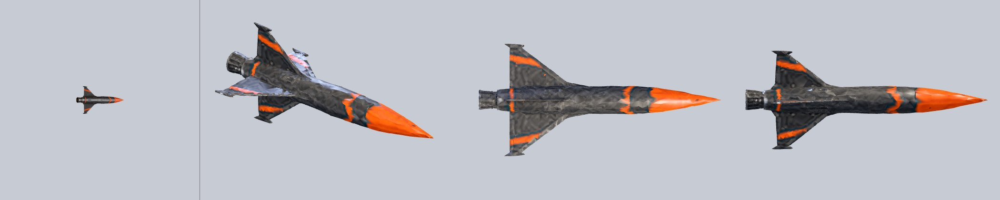
- ⚪ Крестообразное крыло, читается как ракета. Хорошо.

### 4.8 Боссы
Своих моделей нет: боссы — увеличенные «Сквозняк» (84) и «Почтальон» (92).
- 🟡 Боссу нужна своя крупная модель (тяжёлый самолёт или летающая платформа), иначе он не отличается от аса.

---

## 5. Наземная техника (позиция ПВО)

Позиция ПВО: 2 ЗСУ, ЗРК, РЛС и командный бункер. В бою — рельеф из спрайта.

### 5.1 ЗРК
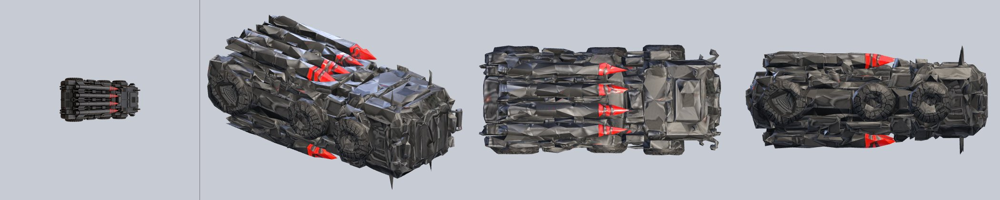
- 🔴 Модель в файле лежит на боку (колёса смотрят вбок). Повернуть при чистке.
- 🟡 Ракеты нарисованы ярко-красными, выглядят игрушечно.

### 5.2 РЛС
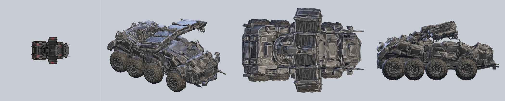
- 🟡 Антенна не выделяется сверху. Для узнавания нужна крупная вращающаяся антенна (как в правке 5, позиция должна читаться с высоты).

### 5.3 Командный бункер
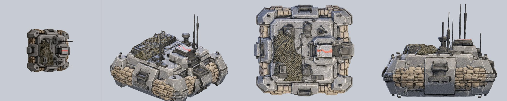
- ⚪ Хорошая модель с мешками. 30 тыс. треугольников, больше нормы; при 10 тыс. ломалась, нужно облегчать аккуратно в Blender.
- ⚪ На крыше красное пятно, похоже на знак. Проверить.

### 5.4 ЗСУ
Единственная модель из кода, без Meshy: платформа на гусеницах, башня, четыре ствола. 468 треугольников.
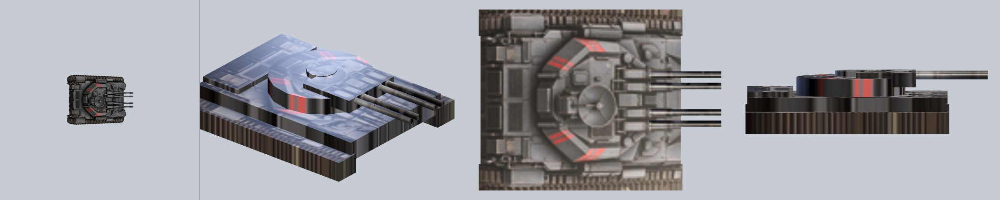
- 🔴 Самая слабая модель каталога: коробка с наложенной текстурой, гусеницы плоские. Пересобрать в Blender (как турели) или сделать в Meshy.

---

## 6. Техника активностей

### 6.1 Свой заправщик
Прилетает при 20% топлива, заправка — держаться у него в хвосте; его атакуют перехватчики. В бою — спрайт `a_tanker`. 3D-модель Meshy есть только «сырая» (`pilot3d/tanker_meshy_raw.glb`), не подготовлена.
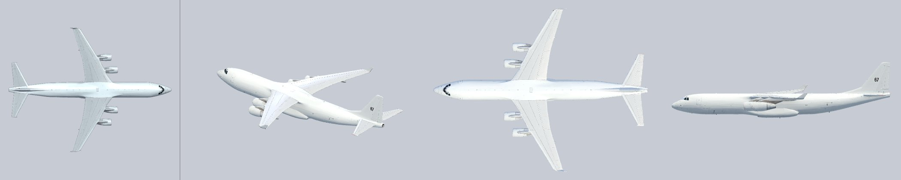
- 🔴 Бортовой номер «67» на киле. Стереть.
- 🔴 Почти копия реального лайнера-заправщика. Нужны изменения силуэта.
- 🟡 Нет заправочной штанги или шланга с конусом. Для узнавания это главная деталь.
- ⚪ Нос в «сырой» модели смотрит назад (не прошла подготовку), 30 тыс. треугольников.

### 6.2 Вражеский транспортник
Цель активности «Охота на транспорт под прикрытием». В бою — спрайт `e_transport`. 3D-модель «сырая» (`pilot3d/transport_meshy_raw.glb`).
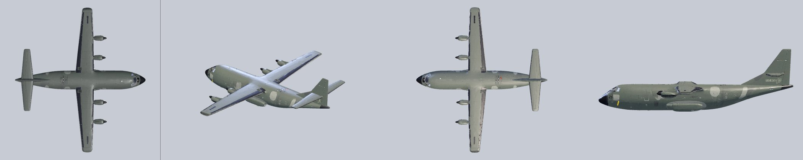
- 🔴 Почти точная копия известного четырёхмоторного транспортника, на киле и борту надписи. Стереть надписи, изменить силуэт (киль, нос, гондолы).
- 🟡 Окраска оливковая, как у своих. Для врага лучше тёмная с красным, как у остальных врагов.

---

## 7. Подбитая техника в биоме

Декорации Нагорья (Meshy, облегчены до 4 тыс.).

**Грузовик-остов**
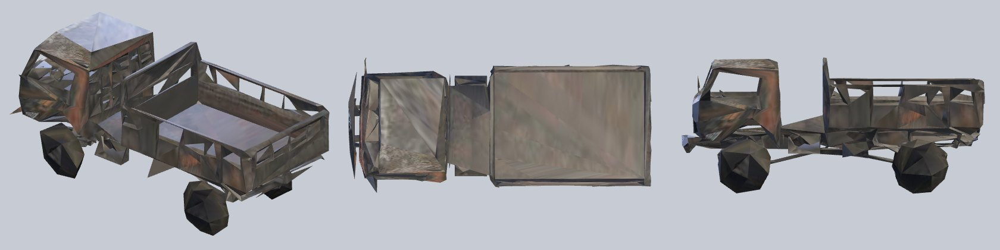
**Танк-остов**
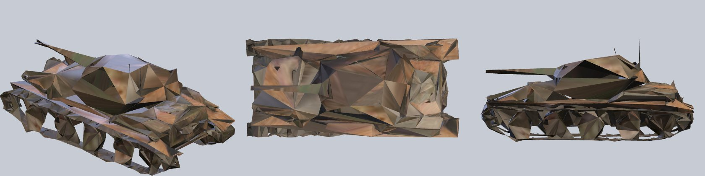
- 🟡 Сильно угловатые после облегчения: колёса граненые, корпус «мятый». Сверху в игре терпимо, вблизи на наклонной камере заметно. Облегчить заново до 6–8 тыс. с сохранением формы колёс.
- ⚪ Танк по силуэту близок к реальному, но как остов допустим.

---

## 8. Сводный список правок для чистки в Blender

По приоритету. Цифры в скобках — разделы выше.

**Сначала (правила проекта):**
1. Стереть знаки и надписи: «Почтальон» (4.4), «Соперник» (4.2), заправщик (6.1), транспортник (6.2), квадрат на «Граче 2» (1.2); проверить «Дрон» (4.6), бункер (5.3), «Сквозняк» (4.3).
2. Отойти от реальных прототипов: транспортник (6.2), заправщик (6.1), «Кит 1» и «Кит 2» (1.3).
3. Убрать шасси у «Кита 2» (1.3).
4. Повернуть ЗРК, подготовить заправщик и транспортник (нос вперёд, облегчение) (5.1, 6.1, 6.2).

**Затем (вид):**
5. Окраска: «Кит» в цвет класса, «Оса 2» в камуфляж «Осы», кили «Осы 2», пятно на крыле «Грача» (1.1–1.3).
6. «Грач 2»: отличие, заметное сверху (1.2).
7. ЗСУ пересобрать (5.4).
8. Оружие: ловушки, кассета бомб, обтекатели НАР и гондолы, головка ракет; сделать ступени различимыми сверху (2.1–2.5).
9. Новые турели: окраска, ступени 1/2/3, кормовая кабина «Кита» (2.7).
10. Остовы: облегчить заново (7).

**Нужно твоё решение:**
- A. Переводить ли бой со спрайтов на 3D-модели (0.1). Рекомендую: да, с облегчёнными моделями, со своих самолётов, с замером FPS.
- B. Нужен ли своя модель босса (4.8) и свой вид эволюций оружия (2.1–2.6).
- C. Окраска ведомых (3).

---

Как перерисовать картинки: скрипт и список моделей в `catalog/tools/` (запуск описан в начале `catalog_render.gd`), кадры ангара — `-- --visual --hangarbench` на ветке PR #22.
