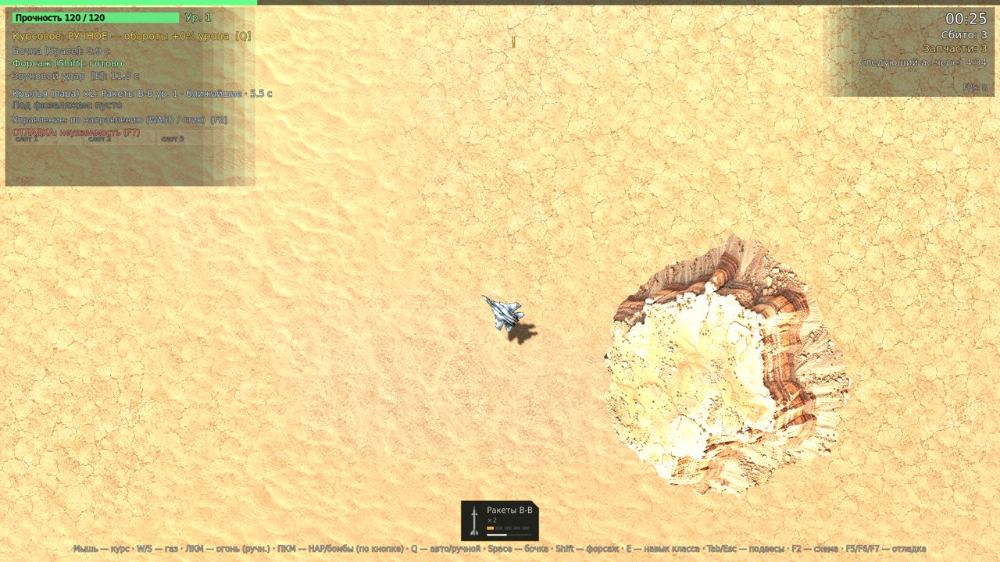
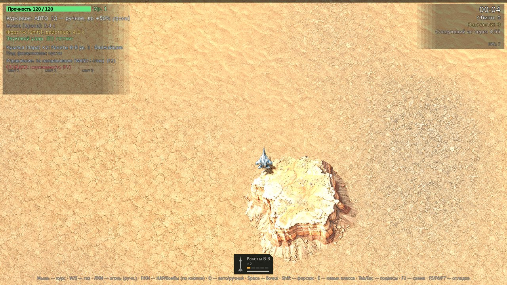
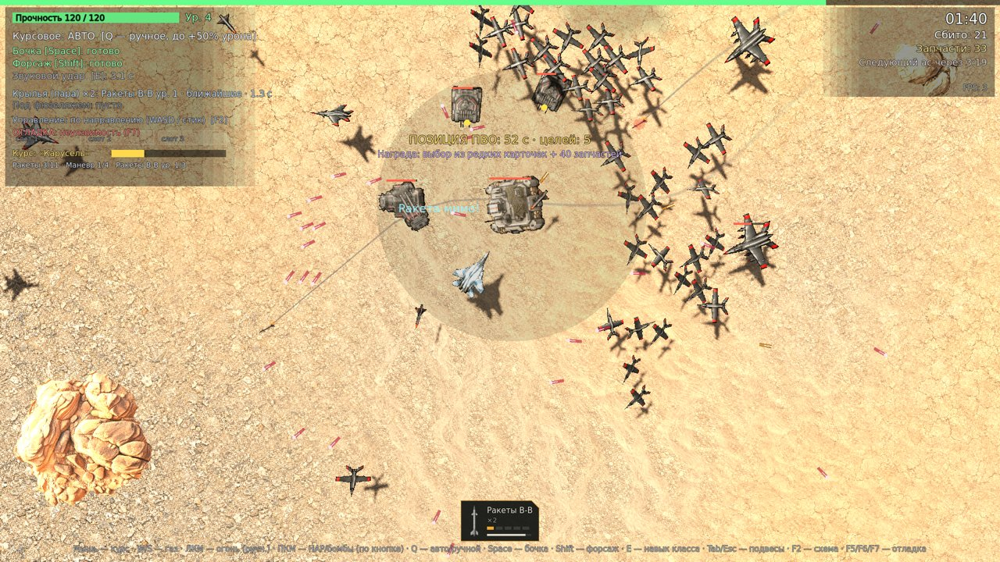
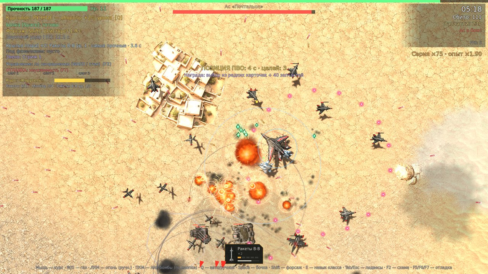
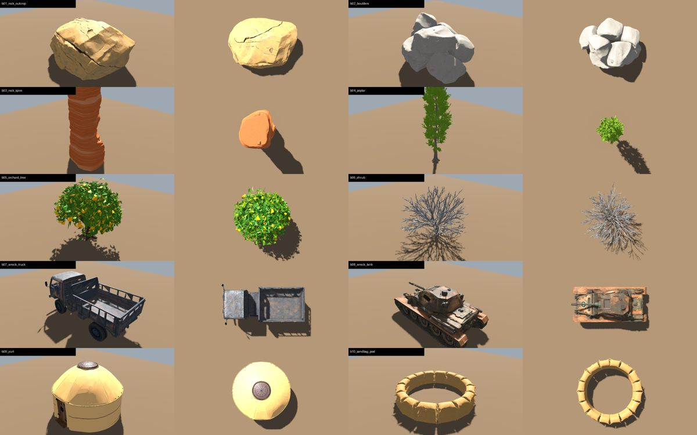

# Flak Heaven — 3D-картинка и биом «Нагорье Шахрисанг»: разбор и задачи

Версия 1 · 14.10.2026 · подготовили АД + ПГ + PM (Claude). Решения — за владельцем проекта.

Цель: максимальное качество картинки и ощущение настоящего 3D при 40 FPS на слабых ПК (решение 14.10).
Задачи ниже уточняют B-21 (рельеф) и B-22 (поселения) и добавляют то, чего в плане 3D не было: свет, качество текстур, разнообразие биома, настройки качества.
Модели техники (Meshy, тред «Модели через API Meshy», PR #3/#5) и рефакторинг B-12 (PR #4) этими задачами не затрагиваются.

## 1. Что есть сейчас (сборка 3.3, проверено 14.10 в облаке)

Запуск: Godot 4.4.1, `--autotest --shots --god --mesatest`, 1920×1080, GL Compatibility. Автотест прошёл без `SCRIPT ERROR`.
FPS на скриншотах (3–8) — программная отрисовка облака без видеокарты, для оценки скорости не годится.

| Скриншот | Что видно |
| --- | --- |
|  | 0:25 — почти весь экран пустой песок, одна «гора» |
|  | Самолёт над «горой»: верх горы выбелен, рельеф — выдавленная картинка |
|  | 1:40 — бой: одна скала на экран, земля однотонная |
|  | 5:18 — кишлак есть, но он плоская картинка без стен и теней |

Как устроено в коде:
- **Земля** (`render3d.gd`, `shaders/ground3d.gdshader`) — плоский квадрат на 70 px ниже плоскости боя. 4 текстуры 1024×1024 (песок, глина, щебень, русло), повтор каждые 460 px, смешивание пятнами по шуму. Нет карт нормалей и шероховатости, нет рельефа, нет защиты от повторов.
- **Объекты** (`background.gd`) — 8 видов (скалы ×2, столовая гора, крепость, кишлак, оазис, воронка, обломки), по одному на клетку 1400×1400 px с вероятностью 62 %. В 3D это выдавленные спрайты (`relief_mesh.gd`) высотой до 48 px.
- **Свет** — фон одного цвета, солнце почти отвесно, фильмовая тональная кривая, тумана и цветокоррекции нет.

## 2. Главные проблемы картинки

1. **Пересвет и плоский свет.** Песок и вершины гор почти белые; в текстурах объектов уже «нарисован» свет, сверху ложится свет движка — двойное освещение. Солнце высоко, тени короткие — объёма мало.
2. **Земля бедная и повторяется.** Трещины и рябь заметно повторяются; без карт нормалей земля не реагирует на солнце; 4 материала на весь биом.
3. **Нет рельефа.** Земля — плоскость, «горы» — картинки. Глубина сцены 70 px: параллакса почти нет, высоким хребтам негде поместиться под самолётом.
4. **Мало элементов и они одиночные.** 1–2 объекта на экран, нет дорог, рек, полей, кишлаков с улицами, следов войны, мелочи (кусты, камни). Нет «картинки места» — Нагорье Шахрисанг не узнаётся.
5. **Объекты — выдавленные спрайты.** Сверху ещё терпимо, на крене и в движении видно «подушку» вместо стен и скал.

Ограничения GL Compatibility (выбран для слабых ПК): нет SSAO, SSR, SDFGI и объёмного тумана. Объём даём текстурами с нормалями, затенением в вершинах рельефа, тенями от низкого солнца, туманом по глубине и деталями.

## 3. Решения, нужные от владельца

| # | Вопрос | Варианты | Рекомендация |
| --- | --- | --- | --- |
| Р-1 | Глубина сцены | А) опустить землю с 70 до ~400–600 px под плоскость боя: настоящие хребты и ущелья, сильный параллакс, самолёт всё так же летит над всем. Б) оставить 70 px | **А** — главный рычаг «ощущения 3D»; геймплей (2D) не меняется, наземные цели уже проецируются на землю |
| Р-2 | Наклон камеры | А) строго сверху, как сейчас. Б) наклон 10–15° | **А** — наклон ломает совпадение 2D-слоя с 3D (пули, интерфейс), большой рефакторинг; объём даём глубиной (Р-1) |
| Р-3 | Источник текстур земли и скал | А) бесплатные библиотеки CC0 (Poly Haven, ambientCG): полные наборы цвет + нормали + шероховатость + высота, коммерция разрешена без указания авторства. Б) генерация в ChatGPT (только цвет, нормали — кодом). В) Meshy (генерация текстур) | **А** как основа, Б/В — для уникальных деталей; лицензию каждого набора записываем в `game/art/LICENSES.md` |
| Р-4 | Объекты биома нейросетью | Скалы, обломки техники, деревья — Meshy; здания — модульно кодом (как в плане 3D, раздел 4) | Так и делать: здания кодом дешевле и дают уровни разрушения |

## 4. Задачи

Приоритет: **P0** — основа, без неё остальное не даёт эффекта; **P1** — основное качество; **P2** — полировка.
Роли — по `docs/team/`: АД — арт-директор, ПГ — программист, ГД — геймдизайнер, АН — аналитик, K — владелец.

Общие правила готовности для всех задач:
- автотест `--autotest --fast --god` без `SCRIPT ERROR`;
- скриншоты «до/после» с одних и тех же точек (стенд B-23) в описании PR;
- самолёты и враги читаются на фоне земли не хуже, чем в 3.3 (земля приглушённая, техника контрастная);
- FPS по стенду B-35 не ниже бюджета; на слабом ПК ≥ 40 FPS на «Низком» качестве;
- без реальных стран, флагов, надписей и узнаваемых мест.

### P0 — основа

**B-23. Стенд скриншотов для сравнения** · ПГ · P0
Флаг `--visual`: фиксированное зерно мира и 6 точек камеры (пустыня, гора, кишлак, русло, бой с взрывами, крупный план самолёта), снимки `user://vis_*.png` в 1920×1080.
Готово, если: два запуска подряд дают одинаковые кадры; снимки лежат в PR каждой задачи этого раздела.

**B-24. Свет, цвет и воздух** · АД + ПГ · P0
Солнце ниже (высота 35–45°) и теплее, заполняющий свет от неба холоднее; экспозиция и тональная кривая без пересвета; лёгкий туман по глубине (дальние и низкие слои голубеют); цветокоррекция (контраст, насыщенность) под палитру нагорья; убрать «нарисованный» свет из текстур объектов или приглушить их.
Готово, если: на снимках стенда < 2 % пикселей с яркостью > 245; у скал и зданий видна теневая сторона; тени длиннее и читаются; техника контрастнее земли, чем в 3.3; FPS не ниже 3.3 больше чем на 5 %.

**B-25. Земля: текстуры высокого качества без повторов** · АД + ПГ · P0 · зависит от Р-3
Наборы PBR 2048×2048 (цвет, нормали, шероховатость, высота) для 8–10 материалов: песок, глиняный такыр, щебень, осыпь, скала, галька русла, поля, сухая трава, грунтовая дорога, снег. В шейдере: смешивание по высоте (камни проступают сквозь песок, а не «растворяются»), защита от повторов (случайный поворот и сдвиг плиток), крупная вариация цвета на километры, детальная текстура вблизи. Сжатие текстур под видеокарты (S3TC/ETC2), мипмапы.
Готово, если: на снимке «пустыня» повтор плитки глазом не находится; земля реагирует на солнце (рельеф трещин и камней виден по теням); видеопамять под землю ≤ 96 МБ на «Высоком», ≤ 32 МБ на «Низком».

**B-26. Рельеф: настоящая сетка высот** · ПГ · P0 · уточняет B-21, зависит от Р-1
Земля из кусков сетки высот (бесконечная карта, куски по 1400 px, 2–3 уровня детализации, без швов): хребты, долины, перевалы, сухие русла, конусы выноса — из шума и правил. Текстура по уклону и высоте: скала на крутых склонах (без растягивания — проекция с трёх сторон), осыпь у подножия, снег на гребнях, песок и поля в долинах. Затенение впадин записывается в вершины. Наземные цели и пятна взрывов ставятся на высоту рельефа. Столовая гора и «горы»-картинки удаляются.
Готово, если: на снимках видны хребты и ущелья с собственными тенями и параллаксом при полёте; рельеф ни в одной точке не выше потолка под плоскостью боя; наземные цели стоят на склонах, а не висят; один и тот же участок карты всегда одинаковый.

**B-27. Решения Р-1…Р-4** · K · P0
Ответы по таблице раздела 3; PM записывает их в журнал решений `docs/game-context.md`.

### P1 — основное качество

**B-28. Объекты биома — настоящие 3D-модели** · АД + ПГ · P1 · уточняет B-22
Ни одного выдавленного спрайта в биоме. Скалы и валуны — 4–6 моделей Meshy (облегчённые для боя) + вариации кодом (масштаб, поворот, цвет). Здания — модульные детали кодом: дувал, дом с плоской крышей, башня, купол, навес, ворота кала; текстуры глина, саман, камень, штукатурка. Повторяющиеся детали — MultiMesh.
Готово, если: у зданий видны стены, крыши и тени во дворах; на крене самолёта нет «подушек»; бюджет на кусок карты ≤ 60 тыс. треугольников и ≤ 40 вызовов отрисовки.

**B-29. Разнообразие элементов биома** · ГД + АД → ПГ · P1
Набор из ≥ 25 видов элементов (сейчас 8), у частых — ≥ 3 варианта:
- поселения: хутор, кишлак, городок с базарной улицей, кала (крепость), здание с куполом без символики, кладбище с камнями;
- вода и зелень: река с галечными берегами, зелёная полоса вдоль воды, тополя рядами, сады, террасные поля (зелёные, жёлтые, убранные), цепочки кяризов, водоёмы;
- дороги: грунтовка с серпантином, мост (каменный, понтонный), брод, блокпост;
- война (уровни 0–3 из плана): мешки с песком, позиции ПВО, окопы, колонны сгоревшей техники, разбитые дома, воронки разных размеров, дым над руинами;
- мелочь: стоянка кочевников (юрты/шатры), загоны, линии электропередачи, вертолётная площадка, кусты, валуны.
Расстановка — кластерами по правилам (кишлак у воды → поля → дорога → мост), а не «один предмет на клетку»; открытые площадки для боя сохраняются.
Готово, если: на 10 случайных снимках 1920×1080 в ≥ 8 есть хотя бы один «интересный» элемент, при этом ≥ 40 % площади экрана — открытая земля; по трём снимкам владелец узнаёт долину, кишлак и перевал.

**B-30. Мелкие детали на земле** · ПГ · P1
Кусты, камни, сухая трава, мусор — тысячи экземпляров MultiMesh по маске материала, с плавным исчезновением на расстоянии и плотностью от настройки качества.
Готово, если: на снимке «пустыня» земля не выглядит пустой; на «Низком» деталей нет, и FPS не падает.

**B-31. Вода и растительность** · ПГ + АД · P1
Шейдер реки: течение, отражение неба, мокрый берег, отмели; деревья и кусты покачиваются от ветра (в шейдере вершин); тени облаков бегут по рельефу.
Готово, если: на снимке «русло» вода читается как вода в движении (видео 5 с в PR).

**B-32. Следы боя на 3D-земле** · ПГ · P1
Воронки и выжженные пятна ложатся по рельефу, горящие обломки с дымом, пыль от взрывов у земли, разрушение зданий на уровень при попадании (по желанию ГД).
Готово, если: после боя с 30+ взрывами место боя видно с воздуха; FPS не проседает ниже бюджета.

**B-33. Настройка «Качество графики»** · ПГ · P1
В меню «Настройки» → «Графика»: «Качество графики» — «Низкое», «Среднее», «Высокое», «Максимальное»; внутри: размер теней, плотность деталей, размер текстур, дальность детализации, сглаживание, масштаб отрисовки. При первом запуске — автоматический выбор по видеокарте.
Готово, если: «Низкое» даёт ≥ 40 FPS на слабом ПК (класс Intel UHD 620) по отчётам тестеров; «Максимальное» — ≥ 60 FPS на GTX 1060 / RX 580.

**B-35. Замер производительности** · ПГ + АН · P1
Флаг `--bench`: облёт фиксированного маршрута 60 с с боем; в журнал — средний FPS, 1 % худших кадров, треугольники, вызовы отрисовки, видеопамять; эти же цифры уходят в отчёт тестера. Таблица бюджетов в этом документе.
Готово, если: два запуска на одном ПК расходятся < 5 %; бюджеты записаны.

### P2 — полировка

**B-34. Ангар в 3D** · АД + ПГ · P2 · после B-12 (PR #4) и моделей HQ
Вместо картинок — модель полного качества на подставке, свет студии, вращение мышью, подвесы на пилонах.
Готово, если: все 6 самолётов игрока показываются моделями HQ; ангар открывается < 2 с.

**B-36. Небо и облака объёмнее** · ПГ + АД · P2
Облака из нескольких слоёв с подсветкой от солнца и мягкой тенью; дымка над долинами утром/вечером (вариант времени суток на вылет — решение ГД).
Готово, если: облака не выглядят плоскими картинками на крене; самолёт над облаком читается.

### Дополнения ролей (версия 2, 14.10)

Задачи выше — в основном «как картинка выглядит». Ниже — что добавили геймдизайнер, арт-директор, аналитик и продюсер, чтобы биом работал на игру, был единым по стилю и продавал игру на странице Steam.

**B-37. Стайл-гайд 3D-биома** · АД · P0 · до B-24, B-25, B-28
Мудборд (свет, палитра, материалы), диапазоны яркости и насыщенности земли и техники (земля — средняя яркость, приглушённая; техника и снаряды — контрастнее), бюджеты на ассет (треугольники, размер текстур, число материалов), правила «как выглядит уровень войны 0–3», список запретов (флаги, надписи, узнаваемые места и техника).
Готово, если: по документу любую задачу B-24…B-32 можно принять или вернуть без вопросов; к каждому правилу есть пример-картинка.

**B-38. Зоны биома по ходу вылета** · ГД · P1
Вылет — путешествие: 0–5 мин — долина с кишлаками и садами, 5–10 мин — ущелья и перевал, 10–15 мин — горный городок и крепость финального босса. Смена зоны плавная, у каждой — своя палитра материалов и набор элементов (B-29). Карта остаётся бесконечной: зона зависит от времени, а не от места.
Готово, если: спецификация с цифрами и правилами перехода; по трём снимкам (2, 7, 13 мин) видно три разных места; как поймём, что работает — вопрос в анкете тестера «почувствовал ли смену места».

**B-39. Ориентиры и наземные цели в мире** · ГД → ПГ · P1 · связана с B-08
Наземные цели стоят там, где им место: ПВО — у кала и на перевалах, колонны — на дорогах, радар — на гребне. Уникальные ориентиры раз в 1–2 экрана (плотина, крепость на скале, большой мост), чтобы игрок помнил, где был бой.
Готово, если: спецификация правил расстановки; в автотесте ни одна наземная цель не стоит в реке или на обрыве.

**B-40. Уровни войны и разрушение** · ГД + АД → ПГ · P1
Уровень войны 0–3 растёт со сложностью и ходом вылета: целые кишлаки → следы обстрелов → руины и колонны сгоревшей техники. Бомбы и НАР разрушают здания на уровень (рушится крыша, остаются стены, дым). Награда за разрушение — по решению ГД (например, запчасти из складов).
Готово, если: у каждого модульного здания есть 3 состояния; разрушение не роняет FPS ниже бюджета; ГД проверил, не отвлекает ли это от воздушного боя (вопрос в анкете).

**B-41. Доводка моделей биома из Meshy** · ПГ + АД · P1 · после отбора владельцем
Конвейер для элементов биома (тот же `model_lab`, что для техники, после слияния PR #3): облегчение (скалы ≤ 3 тыс., деревья ≤ 2 тыс., обломки ≤ 4 тыс. треугольников), 2 уровня детализации, текстуры ≤ 1024, приглушение «нарисованного» света и выравнивание цвета под палитру B-37, ось и масштаб, коллизия не нужна.
Готово, если: все одобренные модели лежат в `game/models/biome/` и проходят проверку бюджета; превью «как в игре сверху» рядом с землёй.

**B-42. Разбор картинки аналогов** · АН + АД · P1
Скриншоты и трейлеры 6–8 игр с видом сверху (Sublight и др.): что даёт им «объём» (свет, высота камеры, детали, цвет), что отмечают в отзывах про картинку. Вывод — 5–10 конкретных приёмов для нас со ссылками.
Готово, если: у каждого вывода есть источник и номер задачи, на которую он влияет.

**B-43. Оценка картинки в отчёте тестера** · АН + ПГ · P1
В анкету кнопки «Отправить отчёт» — оценка картинки 1–5, «где было красиво / где каша»; в статистику — видеокарта, разрешение, «Качество графики», средний FPS и 1 % худших.
Готово, если: поля приходят в Google Таблицу отчётов; по ним можно сравнить сборки до и после.

**B-44. Витринные кадры для Steam** · ПР + АД → ПГ · P2 · связана с B-13
Режим фото (пауза, свободная камера сверху, скрыть интерфейс) и 5 «витринных» мест биома на фиксированном зерне — для скриншотов страницы Steam и трейлера.
Готово, если: снимки 1920×1080 и 3840×2160 без интерфейса; ПР отобрал 5 кадров для страницы.

## 5. Порядок

1. Сразу (без решений): B-23, B-37, B-42 → B-24. Отбор моделей Meshy (раздел 6) — владелец.
2. После Р-1 и Р-3: B-25 и B-26 параллельно, затем B-33 и B-35.
3. Затем B-41 → B-28 → B-29 (с B-38, B-39) → B-30, B-31, B-32, B-40; B-43 — к следующей тестовой сборке.
4. Полировка: B-34, B-36, B-44.

Каждый шаг — отдельный PR со снимками стенда. Новую сборку для тестеров делаем только по отдельной задаче.

## 6. Модели биома из Meshy — партия 1 (14.10, ждёт отбора владельцем)

Текст → 3D (Meshy, модель latest, ремеш до ~30 тыс. треугольников, PBR). Потрачено 300 кредитов (10 × 30), остаток 304.
Файлы: общая папка проекта `biome3d/raw/*.glb` (+ превью Meshy `*_thumb.png`), лист превью `biome3d/biome_meshy_previews.jpg`, скрипт `biome3d/meshy_biome.py`. В репозиторий модели не кладём до отбора и доводки (B-41).

| Файл | Что | Треуг. | Первое впечатление (АД) |
| --- | --- | --- | --- |
| b01_rock_outcrop | Скальный выход | 31 тыс. | гладкий «валун», слоёв почти нет; годится как крупный камень |
| b02_boulders | Груда валунов | 31 тыс. | хорошая форма, слишком белый — цвет поправим кодом |
| b03_rock_spire | Скальный столб | 31 тыс. | слоистый, но гладкий; сверху читается слабо |
| b04_poplar | Тополь | 28 тыс. | хороший силуэт сбоку, сверху маленький — для рядов вдоль дорог |
| b05_orchard_tree | Абрикос | 21 тыс. | читается сверху, сады — да |
| b06_shrub | Колючий куст | 31 тыс. | хорош; для мелочи (B-30) нужно сильно облегчить |
| b07_wreck_truck | Сгоревший грузовик | 29 тыс. | хорош для колонн |
| b08_wreck_tank | Сгоревший танк | 30 тыс. | хорош, но силуэт похож на реальные машины 1940-х — проверить на «по мотивам» |
| b09_yurt | Юрта | 29 тыс. | хороша; стоянка кочевников |
| b10_sandbag_post | Позиция из мешков | 30 тыс. | хороша для уровней войны |

Модели не переделывались: отбор и решение «переделать» — за владельцем.
