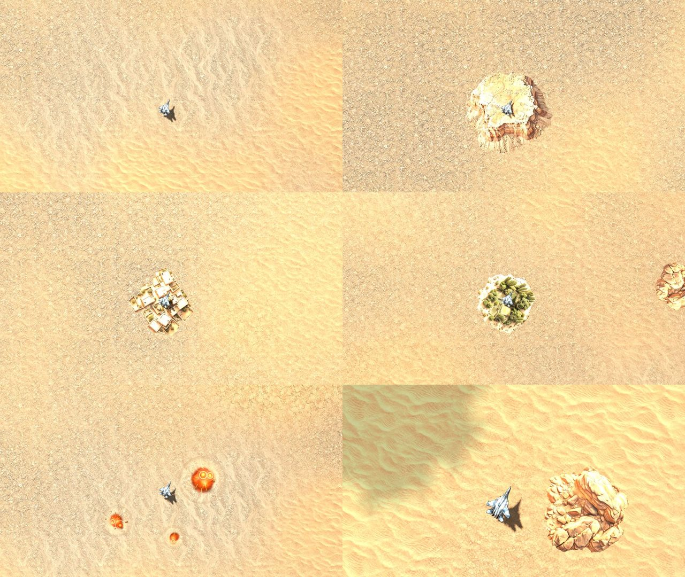
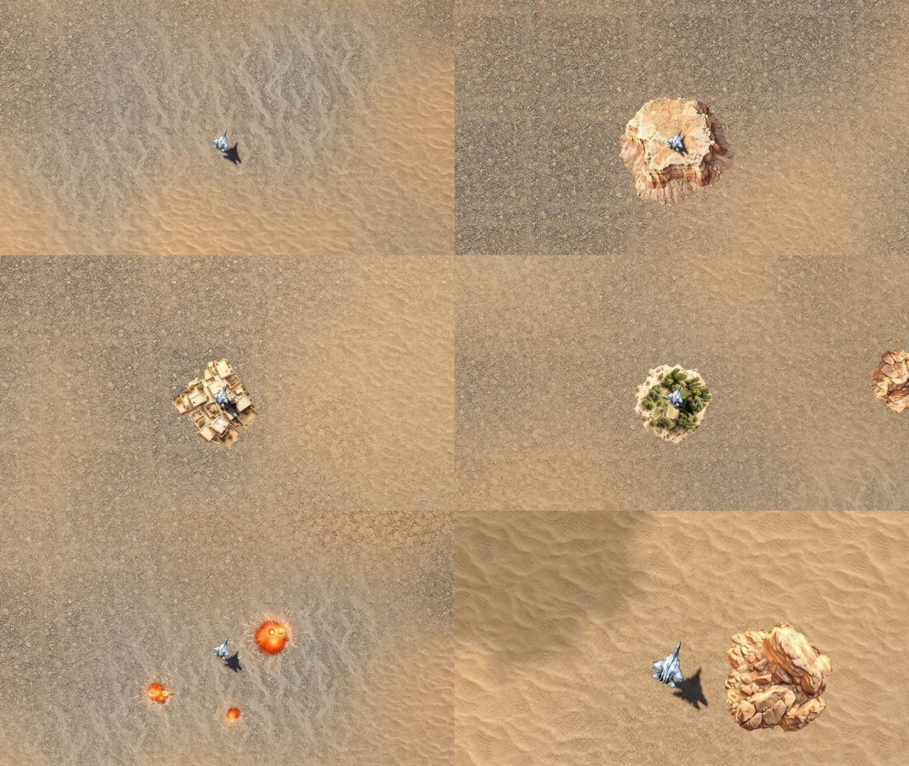

# Стайл-гайд 3D-биома «Нагорье Шахрисанг» (B-37)

Версия 1 · 14.10.2026 · арт-директор (Claude). Утверждает владелец проекта.
Заменяет пиксельный стайл-гайд v0 (`s1-08-art-styleguide.md`) для мира в 3D; цвета своих и врагов, снарядов и интерфейса из v0 остаются в силе.
По этому документу принимаются или возвращаются задачи B-24…B-32 и B-41.

## 1. Главное в пяти правилах

1. **Земля — сцена, техника — актёры.** Земля приглушённая, средней яркости и тёплая; техника, снаряды и вспышки — контрастнее и холоднее земли.
2. **Свет — низкое тёплое солнце и холодное небо.** Солнце сверху-слева экрана на ~40° над горизонтом, тени уходят вниз-вправо и голубоватые, а не серые.
3. **Объём — из света, а не из рисунка.** В текстурах нет «нарисованного» солнца и теней: их даёт движок. Картинки с запечённым светом приглушаем или заменяем.
4. **Место узнаётся.** Сухое нагорье Центральной Азии по мотивам: охра, глина, щебень, тополя вдоль воды, глинобитные кишлаки, террасы. Без реальных стран, надписей, флагов и узнаваемых мест.
5. **Каша запрещена.** В любом кадре ≥ 40 % площади — спокойная открытая земля; мелкие детали не ярче и не контрастнее врагов.

## 2. Свет и цвет (уже в игре после B-24)

| Что | Значение | Где в коде |
| --- | --- | --- |
| Солнце | цвет `#ffe6c2`, сила 1,15, направление (0,62; −0,85; 0,75) — ~40° над горизонтом | `render3d.gd` |
| Небо (заполняющий свет) | цвет `#99add1`, сила 0,5 | `render3d.gd` |
| Тональная кривая | Filmic, экспозиция 1,0 (`light_exposure`), контраст 1,08, насыщенность 1,05 | `render3d.gd`, `tuning.gd` |
| Яркость земли | множитель 0,85 (`ground_albedo`) | `ground3d.gdshader`, `tuning.gd` |
| Яркость объектов биома | множитель 0,85 (`obj_albedo`) | `render3d.gd`, `tuning.gd` |

Проверка — стенд `--visual` (B-23), в журнале у каждого кадра `lum` (средняя яркость 0–255) и `hot` (доля пикселей ярче 245).

| Показатель | Цель | 3.3 (до) | После B-24 |
| --- | --- | --- | --- |
| Средняя яркость кадра `lum` | 130–165 | 209–221 | 143–162 |
| Пересвет `hot` | < 2 % | 8–19 % | 0,02–0,27 % |

| До (3.3) | После (B-24) |
| --- | --- |
|  |  |

## 3. Палитра земли

Средние цвета текстур (что сейчас в игре) и куда двигаемся. Материалы земли держим в одном «семействе»: тёплые охры и серо-коричневые, без чистых жёлтых и без холодных серых.

| Материал | Сейчас | Цель (средний цвет текстуры) | Где лежит |
| --- | --- | --- | --- |
| Песок, рябь | `#9e8061` | `#9a7e60` | долины, конусы выноса |
| Глина, такыр | `#937a5f` | `#8f765c` | плоские участки, вокруг кишлаков |
| Щебень | `#7c7063` | `#786c5f` | склоны, подножия |
| Галька русла | `#7d7871` | `#77736c`, у воды темнее и холоднее | сухие и живые русла |
| Скала (новая) | — | `#7a6a5a` … `#8c7864`, слоистая, с красноватыми пропластками `#8a5e48` | крутые склоны |
| Осыпь (новая) | — | `#857463` | подножия скал |
| Поля и сады (новые) | — | зелень `#5c6b3a` … `#6f7a42`, жнивьё `#a08a58` | вдоль воды, террасы |
| Снег (новый) | — | `#d8dbe0` с голубыми тенями, только на гребнях | гребни выше уровня снега |

Правило яркости: средняя яркость любого материала земли на кадре — 120–175 из 255; самая светлая деталь земли не ярче самой тёмной части своего самолёта на светлом фоне.

## 4. Техника и читаемость

- Свои самолёты — сталь `#a7b8c6`…`#e6edf0` и акцент класса (из v0); на земле читаются по силуэту и тени.
- Враги — корпус `#7d2b37`…`#c8423f` и акцент типа (из v0). Наземные цели — тот же красный акцент, чтобы не теряться среди обломков.
- Сгоревшая техника биома (Meshy b07, b08) — только оттенки ржавчины и копоти, **без красного**: не путать с живыми врагами.
- Снаряды и вспышки — правила v0 без изменений (свои приглушённые, вражеские яркие).

## 5. Уровни войны (для B-29, B-40)

| Уровень | Что видно | Доля разрушенного |
| --- | --- | --- |
| 0 — мир | целые кишлаки, сады, поля, стада, дым очагов | 0 % |
| 1 — тревога | позиции из мешков (b10), блокпосты, одиночные воронки | до 10 % |
| 2 — бои | разбитые дома без крыш, колонны сгоревшей техники (b07, b08), выжженные поля | 20–40 % |
| 3 — руины | кварталы руин, дым над городком, мосты обрушены | 50–80 % |

Руины — тех же материалов, что целые здания, темнее на 15–25 % и с копотью; без крови и тел.

## 6. Бюджеты ассетов

| Ассет | Треугольники в бою | Уровни детализации | Текстуры | Материалов |
| --- | --- | --- | --- | --- |
| Самолёт игрока / врага | 5–15 тыс. | 2 | ≤ 2048 | 1–2 |
| Наземная техника | 3–8 тыс. | 2 | ≤ 1024 | 1 |
| Скала, валуны | ≤ 3 тыс. | 2 | ≤ 1024 | 1 |
| Дерево | ≤ 2 тыс. | 2 + «плоская» дальняя | ≤ 1024 (листва — общая) | 1–2 |
| Куст, камень-мелочь | ≤ 300 | 1 + исчезновение | общий атлас | 1 |
| Обломки техники | ≤ 4 тыс. | 2 | ≤ 1024 | 1 |
| Здание (модульная деталь) | ≤ 500 на деталь | 1 | общий атлас материалов | 1 |
| Кусок карты целиком | ≤ 60 тыс. | — | — | ≤ 40 вызовов отрисовки |

Ангар и крупные планы — модели полного качества (решение 14.10).

## 7. Запреты

- Флаги, гербы, надписи, номера, буквы на технике и зданиях; религиозная символика.
- Узнаваемые реальные места, здания и техника «один в один» (только «по мотивам» — см. b08, вынесен на проверку).
- Чистые белые и чистые чёрные пятна на земле больше 2 % кадра.
- Нарисованные тени и блики в текстурах земли и объектов.

## 8. Что ещё нужно для полной версии

- Мудборд из фотографий-референсов (горные долины, кишлаки, террасы, русла): соберём из CC0-фото после решения Р-3; реальные фото — только как справочник формы, в игру не идут.
- Примеры-картинки для разделов 3 и 5 появятся с первыми PBR-материалами (B-25) и зданиями (B-28).
